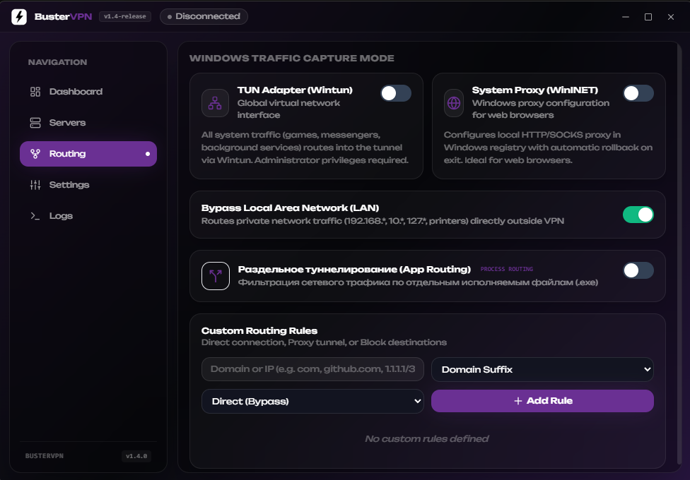

# BusterVPN

<div align="center">

[](Cargo.toml)
[](https://www.rust-lang.org/)
[](https://tauri.app/)
[](https://svelte.dev/)
[](https://tailwindcss.com/)
[](LICENSE)
[](https://github.com/ReinQQ/BusterVPN)

**A high-performance, production-grade desktop VPN client for Xray-core and Hysteria 2.**  
Engineered with Rust, Tauri v2, Svelte 5 runes, and Tailwind CSS.

</div>

---

## Overview

**BusterVPN** is a modern, lightweight, and robust desktop VPN client acting as an advanced process supervisor and networking engine for **Xray-core** and **Hysteria 2**. It eliminates the fragility of legacy GUI wrappers by providing strict kernel-level process containment, automated route lifecycle management, fail-closed firewall kill-switching, DPAPI/permission-hardened configuration storage, and zero-leak network crash recovery.

Designed specifically to bypass modern censorship and DPI throttling while keeping domestic resources directly accessible, BusterVPN combines native systems programming in **Rust** with a responsive **Svelte 5** reactive interface.

<div align="center">
  
  <p><em>Main Dashboard — Real-time connection status, protocol badges, throughput graph, and server control</em></p>
</div>

<div align="center">
  
  <p><em>Routing Configuration — RuNet bypass rules, GeoIP/GeoSite databases, and per-app Split Tunneling</em></p>
</div>

---

## Key Features

### 1. Multi-Protocol Core Engine
- **Xray-core Integration**:
  - **VLESS**: REALITY (uTLS Chrome/Safari fingerprints, ALPN, public key verification), XTLS-Vision flow control, WebSocket with early data, gRPC, and HTTPUpgrade.
  - **VMess**: Standard TCP, WebSocket transports, JSON configurations.
  - **Trojan**: TLS / WebSocket with custom SNI and ALPN negotiation.
  - **Shadowsocks**: AEAD 2022 ciphers, chacha20-poly1305, aes-128/256-gcm, SIP002 URIs.
- **Hysteria 2 Integration**:
  - Full UDP port-hopping support (e.g. `443,10000-20000` port ranges or `mport` syntax).
  - **Salamander** and **Gecko** packet obfuscation (`obfs=salamander`, `obfs-password`).
  - **Brutal** congestion control with upload/download bandwidth tuning (`upmbps`, `downmbps`).
  - Custom SNI, TLS certificate pinning (`pinSHA256`), and Encrypted Client Hello (ECH).

### 2. Flexible Network Operating Modes
- **TUN Mode (Virtual Adapter)**:
  - **Windows**: Wintun kernel driver (`BusterVPN_TUN` / `BusterVPN`) with auto-configured routing tables, physical default gateway discovery, and static `/32` bypass route pinning to guarantee that encrypted uplink traffic never loops into the tunnel interface.
  - **Linux**: Native Linux kernel `/dev/net/tun` driver integration. Operates cleanly with `CAP_NET_ADMIN` capabilities without requiring the entire UI to run as root.
- **System Proxy Mode**:
  - **Windows**: Direct WinINET registry manipulation (`HKCU\Software\Microsoft\Windows\CurrentVersion\Internet Settings`) with atomic backup journals, multi-protocol listeners (`http`, `https`, `socks`), PAC preservation, and `InternetSetOption` live refresh.
  - **Linux**: Desktop integration for GNOME (`gsettings`) and KDE Plasma (`kwriteconfig5`).
- **Dual Mode (TUN + System Proxy)**: Runs both simultaneously for complete system coverage.
- **Local Proxy Only**: Leaves system network settings untouched, exposing local SOCKS5 (port `10808`) and HTTP (port `10809`) listeners for selective tool or browser routing.

### 3. Intelligent Routing & RuNet Bypass
- **Geo-Routing Databases**: Bundled `geoip.dat` and `geosite.dat` provide instantaneous out-of-the-box bypass for Russian services (`geosite:category-ru`, `geosite:ru`, `geoip:ru`) and local private IP ranges (`geoip:private`).
- **App-Based Split Tunneling**: Route specific applications (`.exe` processes on Windows or binaries on Linux) through the VPN while leaving other software on the direct local connection, or vice versa (Bypass vs. Proxy modes).
- **Domain & IP Rules**: Flexible custom routing rules supporting Direct, Proxy, and Block actions with automated Punycode/IDN Cyrillic domain normalization.
- **QUIC / HTTP3 Throttling Defense**: Optional automatic blocking of outbound UDP port 443 in TUN mode forces web browsers to fall back to clean TCP TLS 1.3, evading ISP UDP throttling.

### 4. Process Isolation & Fail-Closed Kill Switch
- **Kernel-Level Process Isolation**:
  - **Windows**: Child core processes are assigned to a Win32 **Job Object** configured with `JOB_OBJECT_LIMIT_KILL_ON_JOB_CLOSE` and `JOB_OBJECT_LIMIT_DIE_ON_UNHANDLED_EXCEPTION`. If the application exits, terminates, or crashes, the OS kernel unconditionally kills all core processes.
  - **Linux**: Spawned within an isolated process group and configured with `prctl(PR_SET_PDEATHSIG, SIGTERM)`.
- **Fail-Closed Windows Firewall Kill Switch**:
  - Leverages COM interfaces (`HNetCfg.FwPolicy2`) to set default outbound policy to **Block**.
  - Adds narrowly scoped allow-rules for core executables, local loopback (`127.0.0.1`, `::1`), essential DNS (UDP/TCP 53), DHCP, and the VPN server's pinned `/32` host IP.
  - If the core process terminates unexpectedly, outbound traffic remains blocked to prevent unencrypted IP leaks.
- **Session Journal & Crash Recovery**:
  - Every connection transaction writes a recovery journal (`session.json`, `killswitch_journal.json`, `proxy_journal.json`).
  - On application startup, `startup_recovery()` automatically cleans up dangling processes (verifying PID creation time), restores firewall rules, disables stale system proxies, flushes DNS cache, and dismantles orphaned Wintun adapters.

### 5. Universal Importer & Deep-Link Handler
- **Universal Importer**: Parses raw share links (`vless://`, `vmess://`, `trojan://`, `ss://`, `hysteria2://`, `hy2://`), plain URI lists, Base64-encoded bundles, Clash YAML configs (`proxies:`), and Sing-box / Xray JSON formats.
- **Deep-Link Protocol Integration**: Registered OS protocol handler for `bustervpn://`, with compatibility parsing for `sub://`, `v2rayng://`, `hiddify://`, and `clash://`.
- **Subscription Metadata**: Reads and displays `Subscription-Userinfo` bandwidth usage, upload/download quotas, expiration timestamps, and server profile titles.
- **Multi-Probe Latency Tester**: TCP ping latency tester calculating the median of 3 consecutive probes with timeout guards.

### 6. Modern Reactive UI & Security
- **Svelte 5 Runes**: Built on Svelte 5's `$state`, `$derived`, and `$effect` reactive primitives for sub-millisecond UI updates.
- **Obsidian Cyberpunk Design**: Custom frameless window with window controls, responsive navigation, and six selectable accent themes:
  - *Electric Blue*, *Emerald Green*, *Cyber Violet*, *Sunset Amber*, *Crimson Red*, *Arctic Cyan*.
- **Localization**: Full Russian (RU) and English (EN) language support, switchable on-the-fly without restarting.
- **Encrypted Local Storage**:
  - **Windows**: Profile and subscription stores encrypted at rest via Windows **DPAPI** (`CryptProtectData`) with purpose-specific entropy.
  - **Linux**: Strict POSIX file permissions (`0600` for stores, `0700` for configuration directories).
- **Zero Telemetry**: No tracking, analytics, or background telemetry.

### 7. Dual-Channel Auto-Update
- Automatic SHA-256 integrity verification for core binaries (`xray`, `hysteria`, `wintun.dll`) and routing databases (`geoip.dat`, `geosite.dat`).
- Dual-channel VPS manifest resolver with fallback endpoint support and atomic file replacement.

---

## Tech Stack

| Layer | Technologies |
|---|---|
| **Language & Systems** | **Rust (2021 Edition)** — Tokio, Reqwest, Serde, Windows-rs, Libc, SHA-2 |
| **Desktop Shell** | **Tauri v2** (`@tauri-apps/api 2.2+`, single-instance plugin, deep-link plugin, system tray) |
| **Frontend UI** | **Svelte 5** (`^5.20`), **Vite 6**, **Tailwind CSS 3.4**, **Lucide Svelte** |
| **Tunnel Cores** | **Xray-core** (v1.8+), **Hysteria 2** (v2.x+), **Wintun** (v0.14+) |
| **Operating Systems** | **Windows 10 / 11 (x64)**, **Linux (Debian, Ubuntu, Arch Linux, WSL2)** |

---

## Repository Structure

```text
.
├── Cargo.toml                     # Cargo workspace manifest (v1.4.0)
├── Cargo.lock                     # Locked dependency tree
├── build-linux.sh                 # Linux build, dependency & packaging automation
├── cores/                         # Core binaries and routing databases (gitignored)
│   ├── README.md                  # Asset requirements and checksum instructions
│   ├── geoip.dat                  # MaxMind / LoyalSoldier GeoIP database
│   ├── geosite.dat                # GeoSite domain categorization database
│   ├── hysteria.exe / hysteria    # Hysteria 2 core executable
│   ├── wintun.dll                 # Wintun driver DLL (Windows x64)
│   └── xray.exe / xray            # Xray-core executable
├── crates/
│   ├── buster-core/               # Platform-agnostic tunnel models, config builders, parsers
│   │   ├── Cargo.toml
│   │   └── src/
│   │       ├── config/            # Xray JSON and Hysteria 2 YAML generators
│   │       ├── models/            # Profiles, routing rules, enums, split-tunneling models
│   │       └── parsing/           # VLESS, VMess, Trojan, Shadowsocks, Hysteria2, Clash parsers
│   ├── buster-windows/            # Windows-native networking, Win32 APIs, DPAPI, Firewall
│   │   ├── Cargo.toml
│   │   └── src/
│   │       ├── autostart.rs       # HKCU Run registry manager
│   │       ├── dpapi.rs           # Windows CryptProtectData / CryptUnprotectData encryption
│   │       ├── firewall.rs        # Windows Firewall COM fail-closed kill switch
│   │       ├── job_object.rs      # Win32 Job Object lifecycle supervisor (KILL_ON_JOB_CLOSE)
│   │       ├── process.rs         # Hidden process launcher & log stream redirection
│   │       ├── proxy.rs           # WinINET / WinHTTP system proxy configuration & journals
│   │       ├── routes.rs          # Default gateway resolution, /32 bypass, Wintun management
│   │       └── session_journal.rs # Crash recovery and orphan process reaper
│   └── buster-app/                # Main Tauri v2 application binary and IPC orchestrator
│       ├── Cargo.toml
│       ├── tauri.conf.json        # Window specs, tray configuration, and bundle targets
│       ├── frontend/              # Svelte 5 single-page application
│       │   ├── package.json
│       │   ├── vite.config.js
│       │   ├── tailwind.config.js
│       │   └── src/
│       │       ├── App.svelte     # Root application component
│       │       ├── lib/components/# UI controls, graphs, status indicators, modal dialogs
│       │       └── lib/views/     # Dashboard, Servers, Routing, Activity Logs, Settings
│       └── src/
│           ├── commands.rs        # Tauri IPC command definitions
│           ├── main.rs            # Application bootstrap, single-instance mutex, system tray
│           ├── platform/          # Cross-platform networking abstractions (Linux & Windows)
│           ├── services/          # SessionCoordinator, SubscriptionService, UpdaterService
│           └── storage/           # ProfileStore, SubscriptionStore, SettingsStore
└── docs/
    ├── ARCHITECTURE.md            # Comprehensive architectural specification & state machine
    └── screenshots/
        ├── dashboard.png          # Main Dashboard screenshot
        └── routing.png            # Routing configuration screenshot
```

---

## Build & Installation

### Prerequisites

#### Windows
- **Windows 10 (1809+) or Windows 11 (x64)**
- **Rust Toolchain**: Stable channel (`rustup default stable`, `x86_64-pc-windows-msvc`)
- **Node.js**: v18+ or v20+ LTS with `npm`
- **Tauri CLI**: `cargo install tauri-cli --version "^2.0"`
- **Core Binaries**: Place `xray.exe`, `hysteria.exe`, `wintun.dll`, `geoip.dat`, and `geosite.dat` into `cores/`.

#### Linux (Debian / Ubuntu / Arch)
- **Rust Toolchain**: Stable channel
- **Node.js**: v18+ or v20+ LTS with `npm`
- **System Libraries**:
  ```bash
  sudo apt-get install -y build-essential curl libssl-dev libgtk-3-dev \
    libwebkit2gtk-4.1-dev libayatana-appindicator3-dev librsvg2-dev libjavascriptcoregtk-4.1-dev
  ```

---

### Step-by-Step Build Instructions

#### 1. Windows Build

Open PowerShell in the project root:

```powershell
# 1. Install frontend dependencies and verify build
cd crates\buster-app\frontend
npm install
npm run build
cd ..\..\

# 2. Run automated workspace tests (66+ unit & integration tests)
cargo test --workspace

# 3. Build release executable and NSIS installer
cargo tauri build
```

The resulting binaries will be located at:
- Unpacked Executable: `target\release\buster-app.exe`
- NSIS Installer: `target\release\bundle\nsis\BusterVPN_1.4.0_x64-setup.exe`

#### 2. Linux Build

Run the automated build script:

```bash
chmod +x build-linux.sh
./build-linux.sh
```

Or execute the steps manually:

```bash
# Install frontend packages
cd crates/buster-app/frontend && npm install && npm run build && cd ../../

# Run test suite
cargo test --workspace

# Build Tauri binary
cargo tauri build
```

#### Network Capabilities for Linux TUN Mode
On Linux, TUN mode utilizes the kernel's `/dev/net/tun`. To run TUN mode without launching the entire GUI as `root`, assign `CAP_NET_ADMIN` capabilities:

```bash
sudo setcap cap_net_admin,cap_net_bind_service=+ep target/release/buster-app
```

---

## Import URI Examples

BusterVPN accepts share links via clipboard paste, deep links, or subscription URLs. Example formats:

```text
# VLESS Reality (XTLS-Vision)
vless://11111111-2222-3333-4444-555555555555@example.com:443?security=reality&sni=example.com&fp=chrome&pbk=PUBLIC_KEY&sid=abcd1234&type=tcp&flow=xtls-rprx-vision#Frankfurt-Reality

# Hysteria 2 (Salamander Obfuscation & Port-Hopping)
hysteria2://SECRET_PASSWORD@example.com:443,10000-20000?sni=example.com&obfs=salamander&obfs-password=OBFS_SECRET&upmbps=50&downmbps=200#Amsterdam-Hy2

# Trojan (TLS + WebSocket)
trojan://PASSWORD@example.com:443?security=tls&sni=example.com&type=ws&path=%2Ftrojan-ws#Stockholm-Trojan

# Shadowsocks (AEAD 2022)
ss://2022-blake3-aes-128-gcm:BASE64_KEY@example.com:8388#Helsinki-SS

# BusterVPN Deep Link
bustervpn://import?url=https%3A%2F%2Fexample.com%2Fapi%2Fv1%2Fsubscription%3Ftoken%3DSECRET
```

---

## Security Model & Privacy

- **Protected Credential Storage**: Profile configurations, server addresses, UUIDs, and subscription URLs are encrypted via Windows DPAPI (`CryptProtectData`) on Windows, and POSIX `0600` access controls on Linux. Plaintext secrets are never stored.
- **Isolated Per-Session Configs**: Generated Xray JSON and Hysteria YAML configuration files are written to `%LOCALAPPDATA%\BusterVPN\runtime\` and scrubbed upon disconnection.
- **Fail-Closed Outbound Firewall**: When Kill Switch is engaged, outbound traffic is blocked at the Windows Filtering Platform / Windows Firewall level until the session cleanly disconnects.
- **Sanitized Logging**: All application and core logs are scrubbed for credentials, passwords, tokens, and query parameters before being written to disk or displayed in the Activity Log view.
- **No Telemetry**: No third-party analytical SDKs or telemetry beacons exist within the client. Exit IP lookups are performed directly against public IP APIs and can be disabled completely in Settings.

---

## Testing

Run the automated workspace test suite:

```bash
cargo test --workspace
```

The test suite covers:
- Share link parsers (VLESS Reality/Vision, VMess, Trojan, Shadowsocks AEAD, Hysteria 2 port-hopping and Salamander).
- Subscription formats (Base64 variants, Clash YAML `proxies:`, Xray/Sing-box JSON, deep-link dispatchers).
- Xray JSON configuration synthesis (inbound TUN prefixes, outbound interface binding, direct bypass routing, split-tunneling priority).
- Hysteria 2 YAML generation (MTU calculations, port-hopping ranges, route exclusions).
- Windows DPAPI encryption roundtrips and purpose-separated entropy.
- System proxy string generation, registry manipulation, and crash journal recovery.
- Win32 Job Object creation and process lifecycle boundaries.

---

## Documentation

For an in-depth exploration of the system architecture, state machines, and platform internals, see:
- [docs/ARCHITECTURE.md](docs/ARCHITECTURE.md) — Comprehensive architectural contract, state machines, and fail-safe designs.
- [cores/README.md](cores/README.md) — Core binary placement, checksums, and runtime asset layout.

---

## License

This project is licensed under the [MIT License](LICENSE).
