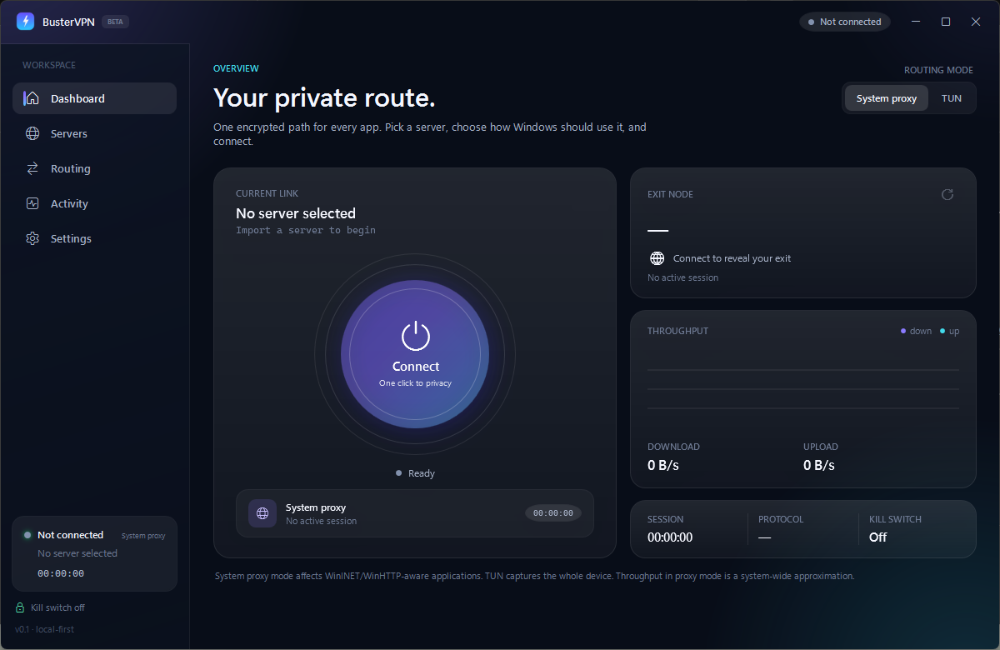

# BusterVPN

**Current release: 0.1.5-beta.**

A production-oriented Windows VPN client foundation for **Xray** and **Hysteria2**, written in C# 12 / .NET 8 with WPF and MVVM.

BusterVPN is a process supervisor and Windows networking shell around two external cores. It does not reimplement any tunnel protocol. It parses share links, builds isolated per-session configs, starts hidden child processes in kill-on-close Job Objects, verifies readiness, applies either a Wintun TUN route or a WinINET system proxy, and guarantees an ordered rollback path.



## What is included

| Area | Status |
|---|---|
| Xray import: `vless://`, `vmess://`, `trojan://`, `ss://` | Implemented (Reality, XTLS-Vision, WS, gRPC, HTTPUpgrade, TLS) |
| Hysteria2 import: `hysteria2://`, `hy2://`, port hopping, Salamander/Gecko, Brutal bandwidth | Implemented |
| Universal import: HTTP(S) subscriptions, `sub://`, `bustervpn://`, `v2rayng://`, `hiddify://`, `clash://` deep links | Implemented; Base64, plain URI lists, raw Xray/Sing-box JSON, and Clash YAML bodies are auto-detected |
| Clipboard smart import | `Paste / Import` reads the clipboard, detects the payload, downloads nodes, and upserts the subscription group |
| Subscription metadata | `Subscription-Userinfo` traffic/expiry, `profile-title` (including `base64:`), and `profile-update-interval` are parsed and shown in Settings/Servers |
| TUN mode | Implemented via core-owned Wintun adapters, admin/Wintun checks, adapter and default-route verification |
| System proxy mode | Implemented with HKCU Internet Settings, PAC capture, crash journal, `InternetSetOption` refresh |
| Routing rules (LAN bypass, domain/IP/CIDR/block) | Implemented for Xray; mapped where supported for Hysteria2 (see limitations) |
| Kill switch | Implemented with Windows Firewall COM + fail-closed profile policy and recovery journal; WFP service is the recommended production upgrade |
| Process lifecycle, port conflicts, crash recovery, orphan cleanup | Implemented with Job Objects, a locked state machine, session journal and ordered teardown |
| Profile and subscription security | DPAPI CurrentUser encryption with per-purpose entropy, no plaintext profile store, ACL-restricted session configs |
| Localization | RU/EN switch applies immediately across views, view models, statuses, tooltips, and the tray menu without a restart |
| Cloud updates & installs | Primary/fallback VPS manifest; SHA-256-verified core downloads with progress and atomic replacement (automatic when all advertised cores are missing, or from Settings); client zip self-update staged and applied through `update.bat`; subscription refresh unchanged |
| UI | Deep obsidian shell with six selectable accent gradients and Inter/Unbounded typography, dashboard, server list with filter/latency, subscriptions, routing, activity log, settings, tray menu, autostart |
| Tests | 165 automated tests passing (parsers, subscriptions, update manifest/fallback, downloader, core install path, archive/extraction, update script, configs including TUN CIDR prefixes, routing modes, TUN adapter selection, TUN bypass routing, Xray TUN outbound binding, IP lookup providers, localization parity, version metadata, logging, DPAPI, process lifecycle) |

This is intentionally a **foundation**, not a claim that every binary-specific behavior has been validated against every core release. See [Production boundary](#production-boundary) below.

## Repository layout

```
BusterVPN.sln
Directory.Build.props
cores/                              # drop downloaded core binaries here (gitignored)
src/
  BusterVPN.Core/                   # platform-neutral: parsing, typed models, config builders
    Configuration/                  # Xray JSON + Hysteria YAML builders
    Diagnostics/                    # LogSanitizer, IAppLogger
    Models/                         # profiles, protocol models, routing, connection state
    Parsing/                        # share-link parsers + link writer for JSON/YAML nodes
    Subscriptions/                  # subscription parser/service, deep links, Clash YAML, cloud models
    Updates/                        # manifest, fallback resolver, downloader, SHA-256, safe zip extraction, update.bat generator
    Processes/                      # IProcessManager / IManagedProcess contracts
    Settings/
  BusterVPN.Windows/                # Windows integration, no WPF dependency
    CoreManagers/
      ProcessManager.cs             # hidden child process start/stop + output capture
      JobObject.cs                  # kill-on-close containment
      SystemProxyManager.cs         # HKCU + WinINET P/Invoke + crash-safe journal
      TunManager.cs                 # Wintun checks, adapter discovery, route verification
      KillSwitchService.cs          # Windows Firewall COM fail-closed policy
      SessionJournal.cs             # crash/orphan recovery
      PortAllocator.cs
      AutostartManager.cs
    Diagnostics/FileLogger.cs
    Infrastructure/AppPaths.cs
    Infrastructure/UriSchemeRegistrar.cs  # HKCU bustervpn:// registration (no elevation)
    Security/                       # DPAPI, ACL hardening, core binary validation
    Storage/                        # encrypted profile/subscription stores, settings store
  BusterVPN.App/                    # WPF / MVVM shell
    CoreManagers/ConnectionCoordinator.cs
    Localization/                   # RU/EN dictionaries, hot-switch service, {loc:Translate}
    Services/
      XrayBackendService.cs
      HysteriaBackendService.cs
      BackendReadiness.cs
      LatencyTester.cs
      IpInfoService.cs
      ThroughputMonitor.cs
      TrayIconService.cs
      SingleInstanceGuard.cs        # named pipe activation with command-line forwarding
      SubscriptionWorkspace.cs      # registry + import pipeline shared by paste, deep links, cloud
      CloudUpdateService.cs         # release manifest + subscription refresh channel
      CoreUpdateManager.cs          # .part downloads, SHA-256 verification, atomic core replacement
      AppSelfUpdater.cs             # client zip staging, update.bat, relaunch
      UpdateDownloader.cs           # streaming download + progress (Core/Updates)
    ViewModels/MainViewModel.cs
    Views/                          # Dashboard, Servers, Routing, Logs, Settings
    Controls/ThroughputGraph.cs
    Themes/                         # premium dark/glass design system
    Converters/
tests/BusterVPN.Tests/
docs/
  ARCHITECTURE.md                   # deep design, state machine, failure matrix
  screenshots/dashboard.png
```

## Runtime layout

The application resolves cores and `wintun.dll` from the **`cores` subfolder of the application directory** (`AppContext.BaseDirectory`). Downloaded updates are written there atomically; a legacy binary in the application root is still accepted for backward compatibility.

```
BusterVPN.exe
BusterVPN.dll
...
cores\
  xray.exe
  hysteria.exe
  wintun.dll          # required for TUN; must match process architecture
```

During development, put the downloaded binaries into the repository-level `cores/` directory. `BusterVPN.App.csproj` mirrors that directory to the build/publish `cores/` output when it exists. Do not commit third-party binaries.

Runtime state is per-user under `%LOCALAPPDATA%\BusterVPN\`:

```
profiles.bin                  # DPAPI CurrentUser encrypted profiles (contains share links/secrets)
settings.json                 # non-secret UI/routing/kill-switch settings
runtime\<session-id>\         # isolated per-session core configs, deleted on teardown
logs\buster-YYYYMMDD.log       # sanitized application/core diagnostics, 14-day retention
system-proxy.backup.json      # present only while a proxy transaction is active
killswitch.backup.json        # present only while the kill switch is armed
active-session.json           # core PID/start-time for orphan recovery
```

## Build and test

Prerequisites:

- Windows 10 1809+ (Windows 11 recommended)
- .NET 8 SDK
- Downloaded cores and architecture-matching `wintun.dll`

```powershell
dotnet build BusterVPN.sln -c Release
dotnet test tests\BusterVPN.Tests\BusterVPN.Tests.csproj
dotnet run --project src\BusterVPN.App\BusterVPN.App.csproj -c Release
```

Or copy cores into the `cores` folder beside the built executable and launch:

```powershell
.\src\BusterVPN.App\bin\Release\net8.0-windows\BusterVPN.exe
```

Debug builds launched via `dotnet BusterVPN.dll` cannot exercise the autostart command (the app checks for `BusterVPN.exe`). That is expected.

### Elevation

- **System proxy mode** works as a standard user (HKCU only).
- **TUN mode** requires administrator rights to create the Wintun adapter and install routes.
- **Kill switch** requires administrator rights to change firewall profile defaults.

The manifest is deliberately `asInvoker`; TUN/kill switch fail with an actionable error instead of silently running half-configured. The production hardening path is an elevated Windows service/privileged broker rather than running the entire UI elevated.

> **Kill-switch recovery:** if BusterVPN crashes while the kill switch is armed, outbound traffic remains blocked. Relaunch BusterVPN **as administrator** so startup recovery can restore the firewall profile defaults, or reset the Domain/Private/Public outbound defaults manually in Windows Security. The journal is `%LOCALAPPDATA%\BusterVPN\killswitch.backup.json`. This behavior is intentional and documented in [docs/ARCHITECTURE.md](docs/ARCHITECTURE.md#8-kill-switch).

## Linux (Ubuntu / Debian / Arch) Support & Building

BusterVPN supports native compilation and packaging on Linux distributions (Ubuntu, Debian, Arch Linux, WSL2):

### 1. Prerequisites & Compilation

Run the automated build script:
```bash
chmod +x build-linux.sh
./build-linux.sh
```

The script will:
- Install required system development libraries (`libgtk-3-dev`, `libwebkit2gtk-4.1-dev`, `libayatana-appindicator3-dev`, `libssl-dev`, `librsvg2-dev`).
- Validate Linux engine cores in `crates/buster-app/cores-linux/` (`xray`, `hysteria`, `geoip.dat`, `geosite.dat`) with `0755` permissions.
- Build the Svelte frontend (`npm run build`).
- Run the full workspace test suite (`cargo test --workspace`).
- Build `.deb` and `.AppImage` packages under `target/release/bundle/deb/` and `target/release/bundle/appimage/`.

### 2. Network Capabilities for TUN Mode

On Linux, `/dev/net/tun` is native to the Linux kernel and does not require third-party drivers (such as Wintun). To use TUN mode without running the entire GUI as root, grant network capabilities:

```bash
# For installed package binary:
sudo setcap cap_net_admin,cap_net_bind_service=+ep /usr/bin/buster-app

# For local release binary:
sudo setcap cap_net_admin,cap_net_bind_service=+ep target/release/buster-app
sudo setcap cap_net_admin,cap_net_bind_service=+ep crates/buster-app/cores-linux/xray
sudo setcap cap_net_admin,cap_net_bind_service=+ep crates/buster-app/cores-linux/hysteria
```

---

## Import examples

Use placeholder credentials only in examples.

```text
vless://UUID@example.com:443?security=reality&sni=www.example.com&fp=chrome&pbk=PUBLIC_KEY&sid=abcd&type=tcp&flow=xtls-rprx-vision#Amsterdam
vmess://BASE64_JSON
trojan://PASSWORD@example.com:443?security=tls&sni=example.com#Trojan
ss://BASE64(method:password)@example.com:8388#SS
hysteria2://AUTH@example.com:443?sni=example.com&obfs=salamander&obfs-password=SECRET&upmbps=50&downmbps=200#HY2
```

## Core commands produced

- Xray: `xray.exe run -c <session>\xray-config.json`
- Hysteria2: `hysteria.exe client -c <session>\hysteria-config.yaml`

Arguments are passed as an argument **vector** (`ProcessStartInfo.ArgumentList`), never through `cmd.exe`.

## Security posture

- Profile store encrypted with DPAPI (CurrentUser) and atomic replacement.
- Logs are sanitized for URLs-with-userinfo and common secret keys before persistence/display.
- Session configs live in random per-session directories, are deleted on teardown, and are never placed beside the UI binary.
- Core children are hidden, run without a shell, assigned to kill-on-close Job Objects, and force-stopped as a tree.
- System proxy changes are journaled before mutation; PAC/AutoDetect are captured and restored; startup recovery handles a crash mid-transaction.
- Kill switch changes are journaled before profile defaults change; startup recovery restores defaults if the process died.
- No telemetry or silent updater exists. The optional exit-IP display (`ipinfo.io`) can be disabled in Settings; the cloud manifest/subscription refresh can be disabled in Settings as well.
- The app never logs full process arguments (share-link payloads may contain provider credentials).
- Subscription URLs are bearer tokens: they are stored only in a DPAPI-protected registry with purpose-specific entropy and are masked in logs/UI (`MaskUrl`).
- Background networking is limited to the opted-in cloud manifest check and HTTP(S) subscription refresh; both fail softly and keep cached nodes when offline. The manifest is fetched from the VPS primary URL with the reserve URL as fallback, and core binaries are compared by SHA-256 before any update is advertised. The exit-IP lookup remains optional and can be disabled.
- Update downloads are SHA-256 verified before installation. Cores are swapped atomically on the same volume (`File.Replace`), client archives are extracted with zip-slip and size limits, and `update.bat` waits for the exiting PID, copies the staged package, relaunches the client, and removes the staging directory.

## Production boundary

The code is structured to be production-ready and compiles/tests cleanly, but shipping it as a commercial VPN client requires work that is intentionally outside a single foundation drop:

1. **Privileged helper**: TUN/kill switch currently run in-process and require elevation. Moving firewall/WFP and route ownership into a signed Windows service with an authenticated IPC channel removes the UAC compromise and makes recovery deterministic.
2. **WFP**: replace firewall profile-default manipulation with a dedicated WFP provider, allow/block filters, and a service-owned watchdog.
3. **TUN adapters**: cores own adapter creation/removal. BusterVPN verifies them but does not forcibly delete a stuck Wintun adapter.
4. **Supported Xray surface**: no SS SIP003 plugins, no VMess TCP+HTTP header obfuscation, no XHTTP/H2. Unsupported links fail with clear errors rather than producing a broken config. Subscription support covers Base64, plain URI lists, Xray/Sing-box JSON, and Clash YAML; other panel formats (for example Surge or Quantumult lists) are reported rather than guessed.
5. **Hysteria2 routing semantics**: Hysteria has no client domain ACL in the supported config; domain bypass is only applied in system-proxy mode. See [docs/ARCHITECTURE.md](docs/ARCHITECTURE.md#9-routing-matrix).
6. **DNS and IPv6**: TUN route readiness is verified for IPv4; IPv6 routes are generated for Xray/Hysteria but are core-owned and not independently verified. DNS leak prevention and split-DNS policy are not implemented at the app layer, and the kill switch intentionally allows system DNS/DHCP traffic. Add explicit DNS policy before claiming leak-proof TUN.
7. **Operationalization**: code signing, Authenticode verification, crash reporting, accessibility/screen-reader audit, and release CI are not included. The VPS manifest carries SHA-256 for the client and each core, core downloads and the client self-update are implemented with hash verification and staging, but publisher-signature verification remains future work. The RU/EN hot-switch and the update manifest parser are in place; the primary and fallback endpoints are configurable.
8. **Test coverage**: parsers, subscription formats, deep links, proxy formatting, DPAPI stores, and process lifecycle have automated tests. Live Xray/Hysteria handshakes, proxy application, TUN routes, and firewall behavior require integration labs and elevated CI runners.

## Acknowledgements / references

Behavior and config shapes were checked against:

- [Xray-core TUN inbound documentation](https://xtls.github.io/config/inbounds/tun.html)
- [Xray REALITY documentation](https://xtls.github.io/config/transports/reality.html)
- [Hysteria2 full client configuration](https://v2.hysteria.network/docs/advanced/Full-Client-Config/)
- [Hysteria2 URI scheme](https://v2.hysteria.network/docs/developers/URI-Scheme/)
- [Windows `InternetSetOptionW`](https://learn.microsoft.com/windows/win32/api/wininet/nf-wininet-internetsetoptionw)
- [Windows Job Objects](https://learn.microsoft.com/windows/win32/procthread/job-objects)
- [Windows Filtering Platform](https://learn.microsoft.com/windows/win32/fwp/windows-filtering-platform-start-page)

See [docs/ARCHITECTURE.md](docs/ARCHITECTURE.md) for the complete architectural blueprint and failure semantics.
