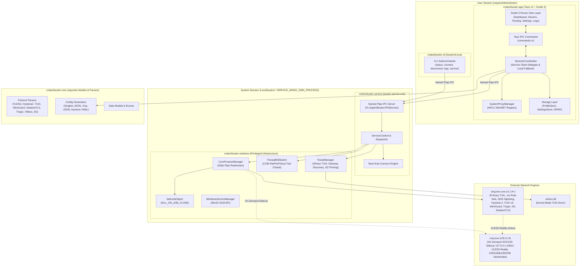
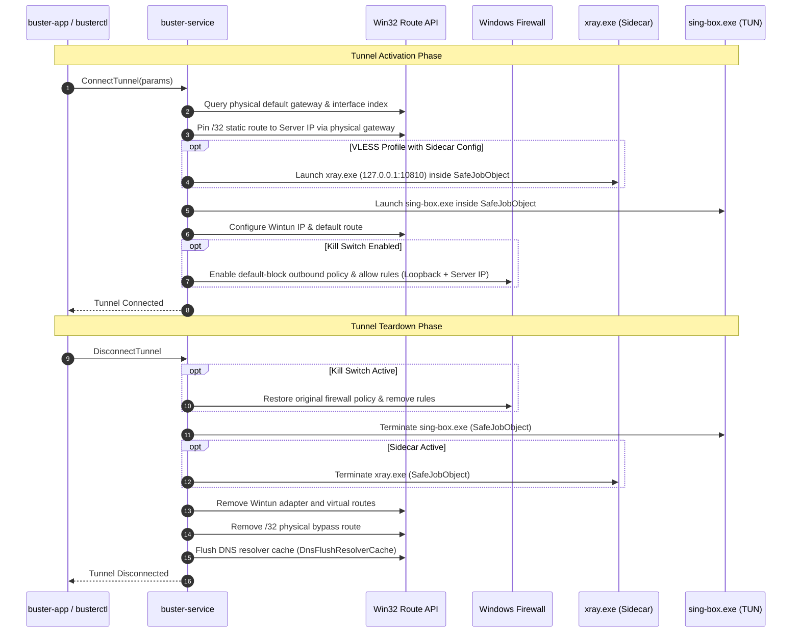

# BusterVPN Architecture Specification

This document defines the architectural contract, subsystem boundaries, IPC communication protocols, process supervision model, and network recovery mechanisms of **BusterVPN v1.5.1**.

---

## 1. System Design Principles

BusterVPN functions as a privileged networking engine and process supervisor for modern proxy protocols. The v1.5.1 architecture adheres to five core engineering principles:

1. **Privilege Separation & Out-of-the-Box Elevation**: While a background Windows Service (`BusterVPNService`) is available for headless and boot-time operations, `buster-app.exe` specifies `requireAdministrator` in its application manifest, ensuring that TUN adapter management and Windows Filtering Platform rules operate immediately out-of-the-box without requiring service pre-installation.
2. **Deterministic Process Containment**: Network core processes must never survive abnormal termination of the host process or a system crash. Process isolation is enforced via Win32 **Job Objects** configured with `JOB_OBJECT_LIMIT_KILL_ON_JOB_CLOSE`.
3. **Fail-Closed Network Safety**: Outbound network traffic is protected by default-block Windows Firewall policies during tunnel activation, with strictly scoped allow rules for local loopback (`127.0.0.1/8`), local subnet DHCP/DNS, core binaries, and pinned `/32` server IP destinations.
4. **Zero Route Looping**: The physical default gateway is identified prior to tunnel creation; a `/32` static host route is pinned to the physical interface so that encrypted uplink packets never route into the virtual Wintun TUN adapter.
5. **Encrypted Storage at Rest**: Profile credentials, private keys, and subscription links are encrypted using Windows **DPAPI** (`CryptProtectData`) with purpose-bound entropy strings.

---

## 2. Subsystem Architecture & Component Map

The workspace contains five Rust crates and a Svelte 5 frontend:



---

## 3. Privilege Decoupling: Service & Named Pipe IPC

### 3.1 Security Descriptor & Access Control
The Windows Service creates the named pipe `\\.\pipe\BusterVPNService` using a permissive DACL string:
```
D:(A;;GRGW;;;WD)(A;;GRGW;;;IU)(A;;GRGW;;;AU)
```
- `WD` (Everyone), `IU` (Interactive Users), and `AU` (Authenticated Users) receive `GENERIC_READ | GENERIC_WRITE`.
- This architecture enables `busterctl.exe` and external tools to interact with the service over Named Pipe IPC, while `buster-app.exe` launches with `requireAdministrator` to ensure direct TUN/Kill Switch fallback capabilities when running standalone.

### 3.2 IPC Wire Protocol
Communication utilizes length-prefixed JSON frames over the named pipe:
- **Header**: 4-byte unsigned 32-bit integer (little-endian) representing the payload length in bytes.
- **Payload**: UTF-8 encoded JSON string matching `IpcRequest` and `IpcResponse` schemas.

#### Supported IPC Commands:
- `Ping`: Connection health check; returns current service version and process ID.
- `GetStatus`: Queries tunnel state (`Connected`, `Connecting`, `Disconnected`, `Error`), active profile name, uptime duration, and operational mode.
- `ConnectTunnel(ConnectTunnelParams)`: Directs the service to write core configs, spawn `sing-box.exe` (and `xray.exe` sidecar if requested) inside a `SafeJobObject`, configure the Wintun adapter, pin `/32` physical bypass routes, and activate the firewall Kill Switch if requested.
- `DisconnectTunnel`: Reverses network modifications, dismantles Wintun routes, flushes DNS, terminates child processes, and releases firewall rules.
- `GetLogs`: Returns the circular memory ring buffer of recent stdout/stderr lines.
- `SetAutoConnectOnBoot(bool)`: Persists boot tunnel activation preference to `service_config.json`.
- `GetServiceConfig`: Reads stored boot connection preferences.
- `StopService`: Gracefully shuts down active sessions and terminates the background service.

---

## 4. Hybrid Network Engine Architecture

BusterVPN v1.5.1 employs an optimized hybrid architecture that pairs `sing-box.exe` with an on-demand `xray.exe` sidecar:

### 4.1 Primary Unified Engine (`sing-box.exe` v1.14+)
`sing-box.exe` is the exclusive primary network engine responsible for system-level routing:
- **TUN Inbound**: Interface name `BusterVPN_TUN`, subnet `172.19.0.1/30` and `fdfe:dcba:9876::1/126`, MTU `1400`, `auto_route: true`, `strict_route: true`, `stack: "system"`.
- **Compiled Binary Rule-Sets (`.srs`)**: Replaces legacy text/protobuf `.dat` files with compiled `.srs` binary databases (`geosite-ru.srs` and `geoip-ru.srs`), drastically reducing router memory footprints and startup latency. Absolute paths are resolved and synced to the runtime directory.
- **Multi-Protocol Outbounds**: Direct protocol execution for Hysteria 2 (UDP port-hopping, Salamander obfs), TUIC v5 (QUIC bbr/cubic), WireGuard (`endpoints` block), ShadowTLS, AnyTLS, Trojan, Shadowsocks, and VMess.
- **Leak-Proof DNS Router**: Hijacks port 53 traffic; routes domestic `.ru`/`.su` queries through local DNS (`77.88.8.8`) and all foreign domain lookups through remote DNS (`1.1.1.1`) detoured via the proxy outbound.

### 4.2 On-Demand Post-Quantum Sidecar (`xray.exe` v26.11.9)
Modern Xray-core servers (v26.9.8+ / v26.11.9+) enforce hybrid post-quantum key exchange (`X25519MLKEM768`) in Reality ClientHello. Upstream `sing-box`'s internal uTLS fork strips ML-KEM extension groups, causing VLESS Reality handshakes to fail with `reality verification failed`.
- **Architectural Solution**: When connecting to a VLESS Reality profile, BusterVPN dynamically generates a minimal standalone Xray config (`xray_detour_config.json`) with an unprivileged loopback SOCKS inbound (`127.0.0.1:10810`, `udp: true`) and a VLESS Reality outbound, spawning `xray.exe run -c xray_detour_config.json` inside the same Win32 `SafeJobObject`.
- **Zero-Dependency Detour**: The sidecar requires no routing rules, no TUN permissions, and zero `.dat` databases (`geoip.dat` / `geosite.dat` are completely unneeded).
- **Sing-box Integration**: `sing-box` emits `{"type": "socks", "tag": "proxy", "server": "127.0.0.1", "server_port": 10810}` as its proxy outbound. `sing-box` retains complete ownership of the Wintun adapter, `.srs` routing, DNS hijacking, and Kill Switch protection.
- **Non-VLESS Protocols**: For all other protocols (Hysteria 2, TUIC, WireGuard, Trojan, Shadowsocks, etc.), BusterVPN runs in pure single-process `sing-box` mode.
- **Legacy Cleanup**: Standalone `hysteria.exe` and legacy `.dat` files have been completely purged from the repository, runtime directories, updater, and installer scripts.

---

## 5. Network Lifecycle & Teardown Sequencing

To prevent plaintext traffic leaks, connection setup and teardown follow strict deterministic sequences:



---

## 6. Crash Recovery & Resilience

### 6.1 SafeJobObject Guarantee
Both `sing-box.exe` and `xray.exe` processes run inside a Win32 Job Object created with `JOB_OBJECT_LIMIT_KILL_ON_JOB_CLOSE`. If `buster-service.exe` or `buster-app.exe` terminates unexpectedly, the Windows kernel terminates all assigned core processes unconditionally.

### 6.2 Session Recovery Journal
Every network change is logged to disk in atomic transaction journals (`session.json`, `killswitch_journal.json`, `proxy_journal.json`). On service startup or application initialization:
1. Dead core processes are detected via PIDs and cleaned up.
2. Lingering firewall block rules are safely dismantled.
3. Orphaned Wintun virtual adapters are released.
4. Per-user WinINET proxy settings are restored to direct connection.
5. Windows DNS cache is flushed.

---

## 7. Security Architecture & Diagnostics

### 7.1 Windows Service Hardening
- Service binary installs to `%ProgramFiles%\BusterVPN\buster-service.exe`.
- Named Pipe security descriptor explicitly denies network access. Only local inter-process callers are authenticated.
- Service IPC parser enforces payload size limits (maximum 16 MB) to prevent denial-of-service memory exhaustion.

### 7.2 Dashboard Diagnostics & Streamer Mode
- **Streamer IP Masking ("Eye" Toggle)**: One-click dashboard toggle masks external IP addresses before rendering in the DOM. State persists in `localStorage` under `bustervpn_hide_ip` across application sessions.
- **Fast DNS & WebRTC Leak Test**: Diagnostic routines run concurrently with strict short timeouts (1.2–2.5s):
  - UDP STUN probes query `stun.l.google.com:19302` and `stun1.l.google.com:19302` to confirm the reflexive address matches the VPN exit IP and no ISP interface leaks.
  - DNS leak test checks upstream resolvers via `whoami.cloudflare` to ensure queries are resolved exclusively through the secure tunnel.
- **Inline SVG Service Icons**: 30+ crisp, lightweight vector icons for popular services (YouTube, Telegram, Discord, Steam, OpenAI, Twitch, etc.) embedded directly without external asset dependencies.
