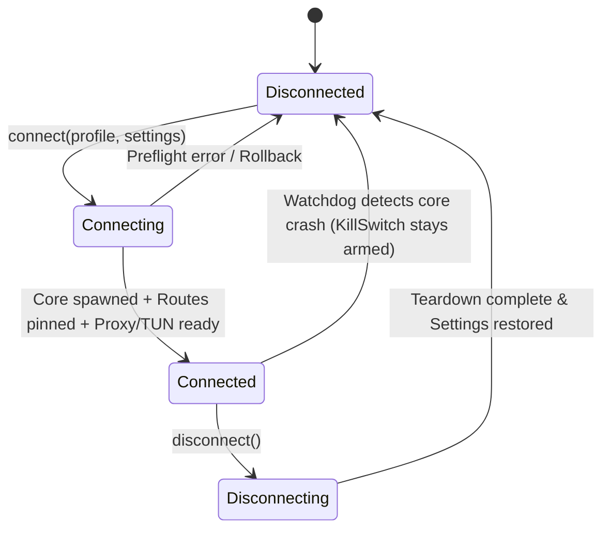
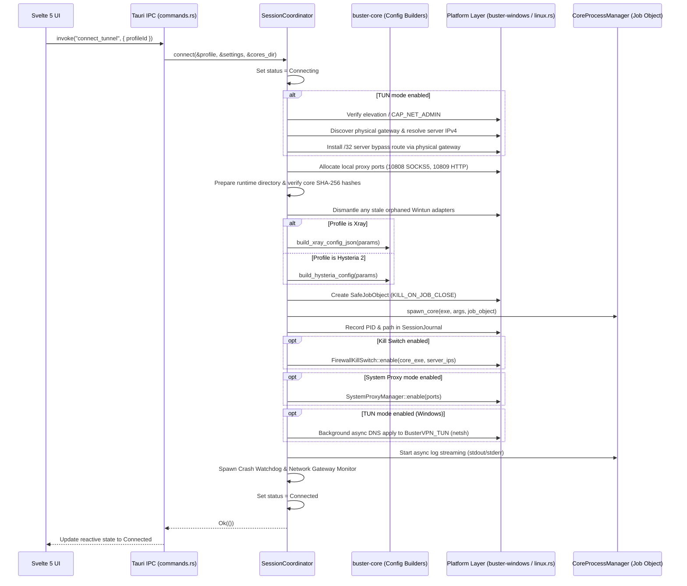
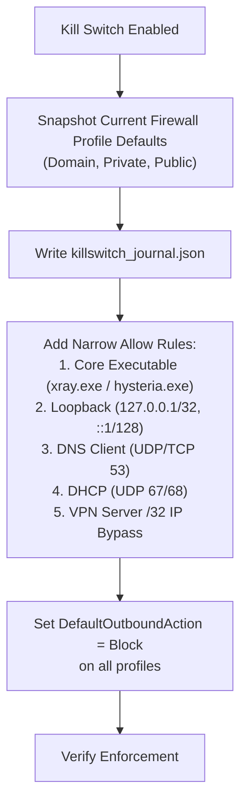

# BusterVPN Architecture

This document defines the architectural contract, subsystem boundaries, connection state machine, process supervision model, and network recovery mechanisms of **BusterVPN** (v1.4.0).

---

## 1. System Goals and Principles

BusterVPN is a high-performance desktop process supervisor and networking engine for external VPN cores (**Xray-core** and **Hysteria 2**). It does not reimplement tunnel cryptographic protocols; instead, it provides native platform orchestration, kernel-level process containment, robust route pinning, fail-closed firewall kill-switching, and leak-proof crash recovery.

### Core Architectural Principles:
1. **Zero-Overhead Native Engine**: Implemented in **Rust (2021 edition)** with **Tauri v2**, providing near-instant startup, tiny memory footprint (< 40 MB idle), and compile-time safety.
2. **Complete Process Containment**: Subordinate VPN cores must never survive an abnormal termination of the host GUI. Windows uses Win32 **Job Objects** (`KILL_ON_JOB_CLOSE`); Linux uses process groups with `prctl(PR_SET_PDEATHSIG)`.
3. **Deterministic Network Side Effects**: Every change to routing tables, virtual adapters, firewall filters, or system proxies is backed by an atomic on-disk journal with automated startup recovery.
4. **Zero-Leak Protection**: Fail-closed firewall rules, physical default gateway host route pinning (`/32`), and strict teardown sequencing ensure plaintext traffic never escapes unencrypted.
5. **Secure Credential Isolation**: Server profiles and subscription URLs are encrypted at rest using platform-native cryptography (Windows DPAPI with entropy / Linux POSIX `0600`).
6. **Reactive Desktop Interface**: Modern UI built with **Svelte 5 runes** (`$state`, `$derived`, `$effect`), communicating asynchronously via Tauri IPC.

---

## 2. Crate & Layer Map

The BusterVPN codebase is partitioned into three specialized Rust crates and a reactive web frontend:

```mermaid
flowchart TB
    subgraph Frontend ["Frontend (Svelte 5 + Tailwind CSS)"]
        UI["Svelte 5 Runes App<br/>(Dashboard, Servers, Routing, Logs, Settings)"]
    end

    subgraph IPC ["Tauri v2 IPC Layer"]
        CMD["commands.rs<br/>(Tauri Commands & State Handlers)"]
        APPSTATE["AppState<br/>(Arc-wrapped Services & Stores)"]
    end

    subgraph AppServices ["crates/buster-app (Application & Services)"]
        COORD["SessionCoordinator<br/>(State Machine, Watchdog, NetMonitor)"]
        SUB_SVC["SubscriptionService"]
        UPDATER["UpdaterService<br/>(Core SHA-256 & Manifest Sync)"]
        LAT_SVC["LatencyService"]
        IP_SVC["IpInfoService"]
        PROFILES["ProfileStore<br/>(DPAPI / 0600)"]
        SETTINGS["SettingsStore"]
    end

    subgraph CoreLogic ["crates/buster-core (Platform-Agnostic)"]
        PARSERS["Parsing Module<br/>(VLESS, VMess, Trojan, SS, Hy2, Clash)"]
        CONFIGS["Config Builders<br/>(Xray JSON & Hysteria YAML)"]
        MODELS["Data Models<br/>(Profiles, RoutingRules, Enums)"]
    end

    subgraph PlatformLayer ["Platform Native Subsystems"]
        subgraph WinSubsystem ["crates/buster-windows (Windows Only)"]
            JOBOBJ["SafeJobObject<br/>(KILL_ON_JOB_CLOSE)"]
            WINPROC["CoreProcessManager<br/>(Hidden Proc, Log Pipes)"]
            WINPROXY["SystemProxyManager<br/>(WinINET Registry & Refresh)"]
            WINFW["FirewallKillSwitch<br/>(COM HNetCfg.FwPolicy2)"]
            WINROUTES["Routes & Wintun<br/>(Gateway, /32 Pinning, DNS)"]
            JOURNAL["SessionJournal<br/>(PID & Crash Recovery)"]
            NETMON["NetworkMonitor<br/>(Gateway Switch Listener)"]
        end

        subgraph LinuxSubsystem ["crates/buster-app/src/platform/linux.rs"]
            LNXPROC["CoreProcessManager<br/>(Process Group + PR_SET_PDEATHSIG)"]
            LNXPROXY["SystemProxyManager<br/>(GNOME / KDE Plasma)"]
            LNXROUTES["Linux Routes & TUN<br/>(/dev/net/tun + ip route)"]
        end
    end

    subgraph Cores ["External Tunnel Cores"]
        XRAY["Xray-core<br/>(VLESS Reality / Vision, VMess, Trojan, SS)"]
        HY2["Hysteria 2<br/>(Port Hopping, Salamander, Brutal)"]
        WINTUN["Wintun Driver<br/>(Windows Kernel TUN)"]
    end

    UI <--> CMD
    CMD <--> APPSTATE
    APPSTATE --> COORD
    APPSTATE --> SUB_SVC
    APPSTATE --> UPDATER
    APPSTATE --> PROFILES
    APPSTATE --> SETTINGS

    COORD --> CONFIGS
    COORD --> PARSERS
    CONFIGS --> MODELS
    PARSERS --> MODELS

    COORD --> WINPROC
    COORD --> WINPROXY
    COORD --> WINFW
    COORD --> WINROUTES
    COORD --> JOURNAL
    COORD --> NETMON

    COORD --> LNXPROC
    COORD --> LNXPROXY
    COORD --> LNXROUTES

    WINPROC --> JOBOBJ
    WINPROC --> XRAY
    WINPROC --> HY2
    WINROUTES --> WINTUN
    LNXPROC --> XRAY
    LNXPROC --> HY2
```



### Crate Responsibility Matrix

| Crate | Target | Key Responsibilities | Dependencies |
|---|---|---|---|
| **`buster-core`** | All platforms | Protocol parsing (VLESS Reality/Vision, VMess, Trojan, Shadowsocks, Hysteria 2, Clash YAML), config builders (Xray JSON, Hysteria YAML), routing rules, IDN Cyrillic normalization, split-tunneling models. | Pure Rust: `serde`, `serde_json`, `serde_yaml`, `url`, `base64`, `uuid`, `regex` |
| **`buster-windows`** | Windows (`x86_64`) | Windows native platform layer: Win32 Job Objects, hidden process spawning with piped logging, WinINET proxy registry and refresh, Windows Firewall COM kill switch, Wintun adapter management, `/32` default gateway route pinning, DPAPI encryption, session crash journals. | `windows` (0.58), `winreg`, `buster-core`, `tokio` |
| **`buster-app`** | All platforms | Tauri v2 desktop application, IPC command handlers (`commands.rs`), application bootstrap (`main.rs`), `SessionCoordinator` connection lifecycle, single-instance guard, system tray, dual-channel auto-updater, Linux platform subsystem (`platform/linux.rs`). | `tauri` (2.x), `buster-core`, `buster-windows` (cfg-guarded), `reqwest`, `tokio`, `sha2` |
| **`frontend`** | Webview | Svelte 5 Single Page Application, Tailwind CSS styling, Lucide icons, interactive dashboard, throughput graphs, server management, routing rule builder, activity logs, settings. | Svelte 5, Vite 6, Tailwind CSS 3.4 |

---

## 3. Frontend-to-Backend Tauri IPC Interaction

Communication between the Svelte 5 frontend and the Rust backend is governed by strictly typed Tauri v2 IPC commands and thread-safe shared application state (`AppState`).

### Svelte 5 Reactivity Model
The frontend uses Svelte 5 **Runes**:
- `$state`: Drives UI views, server lists, connection statuses, throughput data, and active settings.
- `$derived`: Calculates filtered servers, active profile names, ping statistics, and visual connection states.
- `$effect`: Automatically synchronizes form modifications, initiates background polling (e.g. throughput and latency), and binds window resize events.

### IPC Command Registry (`crates/buster-app/src/commands.rs`)

```text
Frontend (invoke) ───────────────────────────────> Tauri IPC Handler
  ├── connect_tunnel(profile_id)                 -> AppState.coordinator.connect(...)
  ├── disconnect_tunnel()                        -> AppState.coordinator.disconnect()
  ├── get_status()                               -> Coordinator state query
  ├── get_profiles() / save_profile()            -> ProfileStore (DPAPI / 0600)
  ├── import_content(text)                       -> Universal import pipeline
  ├── get_subscriptions() / add_subscription()   -> SubscriptionService & Store
  ├── get_settings() / save_settings()           -> SettingsStore
  ├── ping_profile() / ping_all_profiles()       -> LatencyService (TCP Ping)
  ├── check_cores() / update_cores()             -> UpdaterService (SHA-256 sync)
  ├── fetch_ip_info()                            -> IpInfoService (Exit IP lookup)
  └── get_recent_logs()                          -> LogLine ring buffer (400 lines)
```

Real-time logs generated by child core processes (`stdout` and `stderr`) are streamed into an asynchronous Tokio MPSC channel, classified into log severity levels, and maintained in an in-memory ring buffer (capped at 400 lines) accessible to the frontend via `get_recent_logs`.

---

## 4. Connection Lifecycle & State Machine

The central orchestrator of BusterVPN is the `SessionCoordinator` (`crates/buster-app/src/services/session_coordinator.rs`). All state mutations are strictly serialized using asynchronous mutexes to prevent race conditions.

### State Transition Diagram



### Detailed Connection Sequence



---

## 5. Strict Teardown & Disconnection Ordering

To eliminate any window where plaintext traffic could leak outside the encrypted tunnel, the teardown sequence follows an uncompromising, reverse-dependency order:

1. **Stop Network Monitor**: Terminate the gateway monitoring thread to prevent spurious route re-additions during shutdown.
2. **System Proxy Reset**: Immediately reset WinINET (`ProxyEnable = 0`, clear `ProxyServer`) and invoke `InternetSetOption` refresh. Disable GNOME/KDE system proxies.
3. **Release Kill Switch**: Remove firewall block filters and restore default outbound action to `Allow`.
4. **Remove Virtual Routes**:
   - Delete virtual TUN routes (`0.0.0.0/1`, `128.0.0.0/1`).
   - Remove the VPN server's static `/32` host bypass route from the physical routing table.
5. **Terminate Core Process**:
   - Send `SIGTERM` / invoke `TerminateJobObject` on the process tree.
   - Wait for process termination; force kill if not exited within timeout.
6. **Dismantle Wintun Adapter**: Release driver handles and invoke Wintun teardown.
7. **Flush DNS Cache**: Execute `DnsFlushResolverCache` (Windows) or flush systemd-resolved (Linux) to purge cached records.
8. **Clear Crash Journal**: Atomically delete `session.json`, `proxy_journal.json`, and `killswitch_journal.json`.
9. **Transition State**: Set coordinator status to `Disconnected`.

---

## 6. Process Containment & Subsystem Safety

Orphaned VPN processes are a severe hazard in desktop VPN clients: a dangling core can lock the Wintun adapter, monopolize proxy ports, or create routing black holes.

### Windows: Win32 Job Objects (`crates/buster-windows/src/job_object.rs`)
Child core processes are encapsulated in an anonymous Win32 Job Object:
```rust
let mut info = JOBOBJECT_EXTENDED_LIMIT_INFORMATION::default();
info.BasicLimitInformation.LimitFlags =
    JOB_OBJECT_LIMIT_KILL_ON_JOB_CLOSE | JOB_OBJECT_LIMIT_DIE_ON_UNHANDLED_EXCEPTION;

SetInformationJobObject(
    handle,
    JobObjectExtendedLimitInformation,
    &info as *const _ as *const c_void,
    std::mem::size_of::<JOBOBJECT_EXTENDED_LIMIT_INFORMATION>() as u32,
)?;
```
- **Guaranteed Kernel Teardown**: When BusterVPN exits cleanly, crashes, or is killed via Task Manager, the operating system kernel closes the Job Object handle. The kernel terminates all processes assigned to the Job Object unconditionally.
- **No Shell Execution**: Processes are spawned directly using `Command::new(exe_path)` with an explicit argument vector (`Vec<String>`). No intermediate `cmd.exe` or PowerShell shell is invoked, neutralizing command-injection vulnerabilities.
- **Environment Sanitation**: Explicitly sets `NO_COLOR=1` and `FORCE_COLOR=0` to keep log streams cleanly parseable, and pins `XRAY_LOCATION_ASSET` to the runtime directory.

### Linux: Process Groups & `PR_SET_PDEATHSIG` (`crates/buster-app/src/platform/linux.rs`)
- Processes are spawned into a dedicated process group (`cmd.process_group(0)`).
- A pre-execution hook configures kernel-level parent-death signaling:
  ```rust
  unsafe {
      cmd.pre_exec(|| {
          if libc::prctl(libc::PR_SET_PDEATHSIG, libc::SIGTERM) != 0 {
              return Err(std::io::Error::last_os_error());
          }
          Ok(())
      });
  }
  ```
- If the parent `buster-app` process dies, the Linux kernel automatically delivers `SIGTERM` to the child core process.

---

## 7. Network Recovery & Crash Journals (`session_journal`)

If power is suddenly interrupted or the system experiences a hard crash while connected, network settings might be left in an inconsistent state (e.g. system proxy pointing to a dead port or firewall blocking all outbound traffic).

BusterVPN resolves this via atomic on-disk crash journals and the `startup_recovery()` routine.

### The Journal Triumvirate
1. **`session.json`**: Contains active core PID, canonical executable path, and launch timestamp.
2. **`killswitch_journal.json`**: Contains pre-activation firewall outbound profile policies (`Domain`, `Private`, `Public`).
3. **`proxy_journal.json`**: Contains pre-activation WinINET proxy settings, PAC URLs, and auto-detect states.

### Startup Recovery Sequence (`SessionJournal::recover_all_crash_state`)
Every time BusterVPN launches, it performs startup recovery before initializing the UI:
1. **Orphan Process Recovery**: Inspects `session.json`. If a recorded PID is running, it verifies whether the process matches the executable path and creation time before terminating it via `taskkill`.
2. **Firewall Restoration**: Inspects `killswitch_journal.json`. If outbound rules were left in `Block` state, it immediately resets `Domain`, `Private`, and `Public` profiles back to `Allow` and purges residual BusterVPN rules.
3. **System Proxy Rollback**: Inspects `proxy_journal.json`. If WinINET was left pointing to local proxy ports, it clears `ProxyServer`, sets `ProxyEnable = 0`, and calls `InternetSetOption(INTERNET_OPTION_SETTINGS_CHANGED)`.
4. **Adapter Cleanup**: Scans for dangling `BusterVPN_TUN` / `BusterVPN` Wintun adapters and releases driver instances.
5. **DNS Flush**: Clears the system DNS resolver cache to restore clean connectivity.

---

## 8. TUN Mode & Route Architecture

### The Routing Loop Problem & `/32` Host Bypass
In TUN mode, the VPN adapter becomes the default gateway (`0.0.0.0/0` or the split-pair `0.0.0.0/1` and `128.0.0.0/1`). If unmanaged, the core process's own encrypted UDP/TCP packets sent to the remote VPN server would be routed back into the TUN adapter, causing an immediate infinite routing loop and dropping the connection.

BusterVPN prevents this through deterministic route pinning:
1. Before starting the core, `resolve_server_ipv4` resolves the VPN server's hostname to an IPv4 address.
2. `find_physical_gateway` discovers the physical network interface's default gateway (e.g. `192.168.1.1` on Wi-Fi/Ethernet).
3. `add_server_bypass_route` installs a static `/32` host route (`MASK 255.255.255.255`) pointing directly to the physical gateway:
   ```text
   route.exe ADD <VPN_SERVER_IP> MASK 255.255.255.255 <PHYSICAL_GATEWAY> METRIC 1
   ```
4. In Xray JSON configs, the physical interface is bound using `sendThrough` and `streamSettings.sockopt.interface`, ensuring direct rules and DNS queries never enter the virtual TUN interface.

### Dynamic Network Monitoring (`NetworkMonitor`)
On Windows, `NetworkMonitor` utilizes the IP Helper API (`NotifyRouteChange2` / `GetAdaptersAddresses`) to listen for underlying network changes (such as switching from Wi-Fi to Ethernet or roaming between access points). When a gateway change is detected, BusterVPN automatically recalculates the physical gateway and repins the server `/32` bypass route on-the-fly without dropping the tunnel session.

### DNS & QUIC Management
- **DNS Assignment**: Configured with static, reliable DNS resolvers (`1.1.1.1`, `8.8.8.8`). On Windows, `apply_dns_servers` applies resolvers directly to `BusterVPN_TUN` using `netsh`.
- **QUIC / HTTP3 Throttling Defense**: In Xray configurations, outbound UDP port 443 is blocked by default (`"outboundTag": "blocked", "port": "443", "network": "udp"`). This prevents ISPs from throttling or disrupting UDP-based QUIC traffic, forcing web browsers to fall back seamlessly to standard TCP TLS 1.3 over the tunnel.

---

## 9. Fail-Closed Kill Switch

Implemented via Windows Firewall COM automation (`crates/buster-windows/src/firewall.rs`):



### Crash Protection Guarantee
If BusterVPN crashes or the machine loses power while the Kill Switch is armed, outbound traffic remains **blocked** by the Windows kernel. Plaintext data never leaks. On the subsequent launch, `startup_recovery()` automatically restores normal firewall policies.

---

## 10. Routing Matrix & Split Tunneling

BusterVPN configures routing decisions inside the core engine:

| Rule Category | Xray TUN | Xray Proxy | Hysteria 2 TUN | Hysteria 2 Proxy |
|---|---|---|---|---|
| **Private/LAN Bypass** | Direct (`geoip:private`) | Direct (`geoip:private`) | `route.ipv4Exclude` | ProxyOverride |
| **RuNet Bypass** | Direct (`geosite:category-ru`, `geosite:ru`, `geoip:ru`) | Direct (`geosite`, `geoip`) | Custom IP/CIDR excludes | ProxyOverride |
| **App Split Tunneling** | Supported (`process` matching) | Not applicable | Not applicable | Not applicable |
| **Custom Domain Rules** | Supported (with IDN Cyrillic Punycode) | Supported | Direct via SNI/Host | ProxyOverride |
| **Custom IP/CIDR Rules** | Supported (`ip` matching) | Supported | Supported (`route.*Exclude`) | ProxyOverride |

### App Split Tunneling Modes
- **`BypassSelected`**: All applications route through the VPN tunnel, except designated applications (e.g. `discord.exe`, `telegram.exe`, or local banking apps) which are routed directly.
- **`ProxySelected`**: Only designated applications are routed through the VPN tunnel; all other system traffic proceeds directly through the physical ISP connection.

---

## 11. Storage & Credential Security

| Secret / Asset | Storage Mechanism | Access Controls & Encryption | Lifecycle |
|---|---|---|---|
| **Server Profiles & Keys** | `%LOCALAPPDATA%\BusterVPN\profiles.dat` | Windows DPAPI (`CryptProtectData`, CurrentUser scope, magic `b"BVPN1"`) / Linux POSIX `0600` | Persistent until user deletion |
| **Subscription URLs** | `%LOCALAPPDATA%\BusterVPN\subscriptions.dat` | Windows DPAPI with distinct purpose entropy (`SubscriptionStore`) / Linux `0600` | Persistent until subscription deletion |
| **Runtime Core Configs** | `%LOCALAPPDATA%\BusterVPN\runtime\` | Per-session directory with explicit user DACLs | Created on connect; deleted on disconnect |
| **Diagnostics Logs** | `%LOCALAPPDATA%\BusterVPN\logs\` | Plaintext log files; strictly sanitized against URLs, tokens, and keys | 14-day retention cycle |

---

## 12. Failure & Recovery Matrix

| Failure Event | Immediate Behavior | Automated Recovery Path |
|---|---|---|
| **Missing Core Binary** | Connection aborted during preflight; status set to `Disconnected`. | `UpdaterService` automatically triggers download from VPS manifest. |
| **Missing Elevation (TUN)** | Connection aborted before route mutation. | Clear error surfaced in UI asking to run as Administrator or set `CAP_NET_ADMIN`. |
| **Port Conflict (10808/10809)** | Port scanner detects conflict; dynamically selects next available port pair. | Connection proceeds on clean loopback ports. |
| **Core Process Crashes Mid-Session** | Watchdog detects PID termination; logs warning. | If Kill Switch is armed, firewall remains blocked (fail closed) to protect privacy. User disconnects or restarts app to reset. |
| **GUI Abruptly Terminated** | Windows kernel closes Job Object; child processes killed immediately. | Startup recovery clears firewall block and restores system proxy on next launch. |
| **Physical Gateway Switched** | `NetworkMonitor` detects route table change via IP Helper API. | Server `/32` bypass route is automatically removed and re-added for the new gateway. |
| **Corrupted Profile Store** | DPAPI decryption fails or magic header mismatch. | Store is quarantined (`profiles_corrupted_*.bak`) without clobbering; fresh store initialized. |
