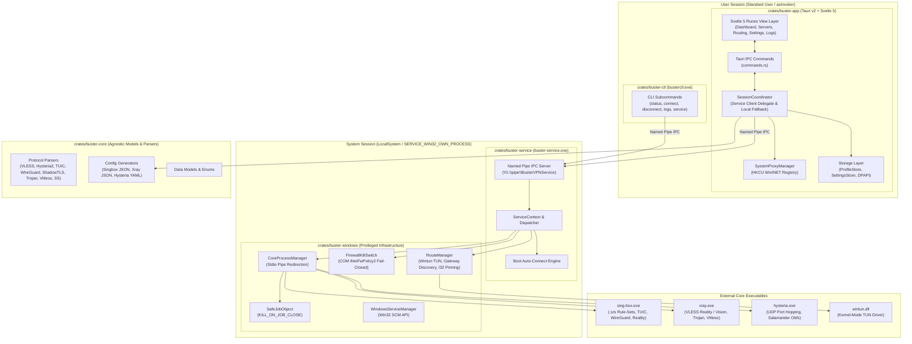
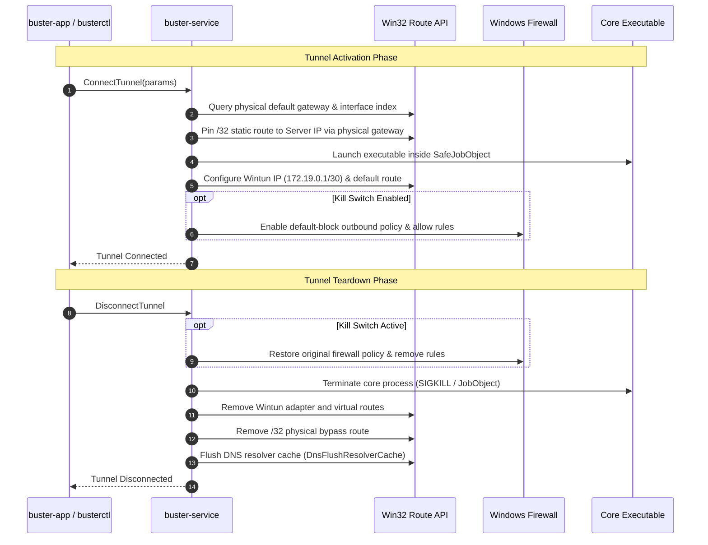

# BusterVPN Architecture Specification

This document defines the architectural contract, subsystem boundaries, IPC communication protocols, process supervision model, and network recovery mechanisms of **BusterVPN v1.5.0**.

---

## 1. System Design Principles

BusterVPN functions as a privileged networking engine and process supervisor for third-party VPN cores (**Sing-box**, **Xray-core**, and **Hysteria 2**). The architecture adheres to five engineering constraints:

1. **Privilege Separation**: Unprivileged user interface processes must never require administrative elevation (UAC prompts) for regular desktop operation. All privileged operations (Wintun adapter creation, IP route table modifications, Windows Filtering Platform firewall rules) reside in a dedicated background Windows Service.
2. **Deterministic Process Containment**: Network cores must never survive abnormal termination of the host process or system crash. Process isolation is enforced via Win32 **Job Objects** configured with `JOB_OBJECT_LIMIT_KILL_ON_JOB_CLOSE`.
3. **Fail-Closed Network Safety**: Outbound network traffic is protected by default-block Windows Firewall policies during tunnel activation, with strictly scoped whitelist rules for local loopback, local subnet DHCP/DNS, and pinned `/32` server IP destinations.
4. **Zero Route Looping**: The physical default gateway is identified prior to tunnel creation; a `/32` static host route is pinned to the physical interface so that encrypted uplink packets never route into the virtual Wintun TUN adapter.
5. **Encrypted Storage at Rest**: Profile credentials, private keys, and subscription links are encrypted using Windows **DPAPI** (`CryptProtectData`) with purpose-bound entropy strings.

---

## 2. Subsystem Architecture & Component Map

The workspace contains five Rust crates and a Svelte 5 frontend:



---

## 3. Privilege Decoupling: Service & Named Pipe IPC

### 3.1 Security Descriptor & Access Control
The Windows Service creates the named pipe `\\.\pipe\BusterVPNService` using a security descriptor string:
```
D:(A;;GRGW;;;WD)(A;;GRGW;;;IU)(A;;GRGW;;;AU)
```
- `WD` (Everyone), `IU` (Interactive Users), `AU` (Authenticated Users) receive `GENERIC_READ | GENERIC_WRITE`.
- This enables `buster-app.exe` (running as an unprivileged user under `asInvoker`) and `busterctl.exe` to send execution commands without triggering UAC elevation.

### 3.2 IPC Wire Protocol
Communication utilizes length-prefixed JSON frames over the named pipe:
- Frame header: 4 bytes unsigned 32-bit integer (little-endian) representing payload length in bytes.
- Frame payload: UTF-8 encoded JSON string matching `IpcRequest` and `IpcResponse` schemas.

#### IPC Command Messages:
- `Ping`: Connection health check; returns current service version and process ID.
- `GetStatus`: Queries tunnel state (`Connected`, `Connecting`, `Disconnected`, `Error`), active profile name, uptime duration, and operational mode.
- `ConnectTunnel(ConnectTunnelParams)`: Directs the service to write core configuration, spawn the core executable inside a `SafeJobObject`, configure the Wintun adapter, pin `/32` physical bypass routes, and enable the firewall Kill Switch if requested.
- `DisconnectTunnel`: Reverses network modifications, dismantles Wintun routes, flushes DNS, terminates child processes, and releases firewall rules.
- `GetLogs`: Returns the circular memory ring buffer of recent stdout/stderr lines.
- `SetAutoConnectOnBoot(bool)`: Persists boot tunnel activation preference to `service_config.json`.

---

## 4. Tunnel Core Integration: Unified Sing-box & Classic Engines

BusterVPN supports two engine architectures switchable in Settings:

### 4.1 Unified Sing-box Engine
`sing-box.exe` handles all inbound and outbound traffic in a single process:
- **Inbounds**:
  - `tun`: Interface name `BusterVPN_TUN`, subnet `172.19.0.1/30`, MTU `1400`, `auto_route: true`, `strict_route: true`, stack `system`.
  - `mixed`: Dual HTTP and SOCKS5 listener bound to `127.0.0.1:10808` / `10809`.
- **Outbounds**:
  - Direct mapping for VLESS (Reality, XTLS-Vision, WS, gRPC), Hysteria 2, TUIC v5, WireGuard, ShadowTLS, AnyTLS, Trojan, VMess, Shadowsocks, `direct`, `block`, and `dns`.
- **Rule-Sets (`.srs`)**:
  - Binary compiled rule-sets (`geosite-ru.srs` and `geoip-ru.srs`) are passed as `rule_set` references for domain and IP classification, reducing memory usage compared to legacy `.dat` files.
- **Process Routing**:
  - Native `process_name` rules direct specified application binaries into either the `direct` outbound (bypass) or tunnel outbound (proxy).

### 4.2 Classic Dual-Engine Architecture
Pairs `xray.exe` for TCP/TLS protocols with `hysteria.exe` for UDP port-hopping links, utilizing text-based `geoip.dat` and `geosite.dat` routing assets.

---

## 5. Network Lifecycle & Teardown Sequencing

To prevent plaintext traffic leaks, connection setup and teardown follow strict deterministic sequences:



---

## 6. Crash Recovery & Resilience

### 6.1 SafeJobObject Guarantee
The Win32 Job Object is created with the `JOB_OBJECT_LIMIT_KILL_ON_JOB_CLOSE` flag. If `buster-service.exe` or `buster-app.exe` terminates unexpectedly, the Windows kernel terminates all assigned core processes unconditionally.

### 6.2 Session Recovery Journal
Every network change is logged to disk in atomic transaction journals (`session.json`, `killswitch_journal.json`, `proxy_journal.json`). On service startup or application initialization:
1. Dead core processes are detected and cleaned up.
2. Lingering firewall block rules are removed.
3. Orphaned Wintun virtual adapters are dismantled.
4. Per-user WinINET proxy settings are restored to direct connection.
5. DNS cache is flushed.

---

## 7. Security Architecture

### 7.1 Windows Service Hardening
- Service binary installed to `%ProgramFiles%\BusterVPN\buster-service.exe`.
- Named Pipe security descriptor explicitly denies network access (`deny network logon`). Only local inter-process callers are authenticated.
- Service IPC parser enforces payload size limits (maximum 16 MB) to prevent denial-of-service memory exhaustion.

### 7.2 Frontend Data Protection
- Streamer IP Masking persists state in `localStorage` under `bustervpn_hide_ip`. When enabled, public IP addresses are masked before rendering in the DOM.
- WebRTC leak test utilizes `RTCPeerConnection` with STUN (`stun:stun.l.google.com:19302`) to verify that gathered ICE candidates do not expose non-tunnel network interface addresses.
- DNS leak test issues queries against `whoami.cloudflare` to verify upstream resolver assignment.
