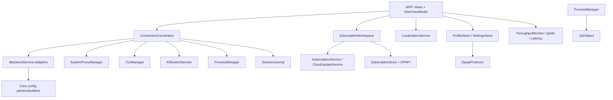
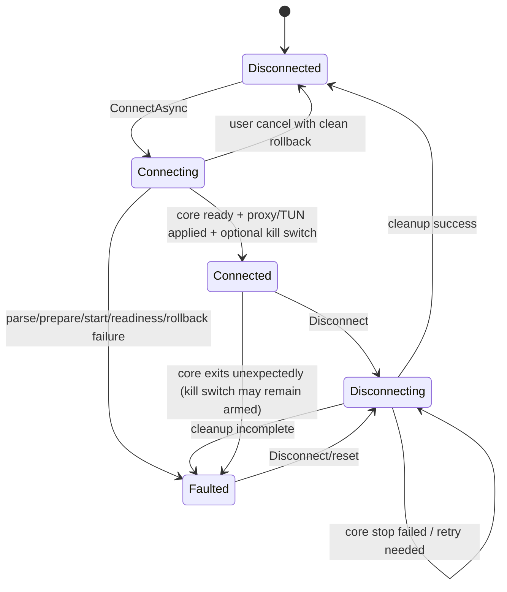
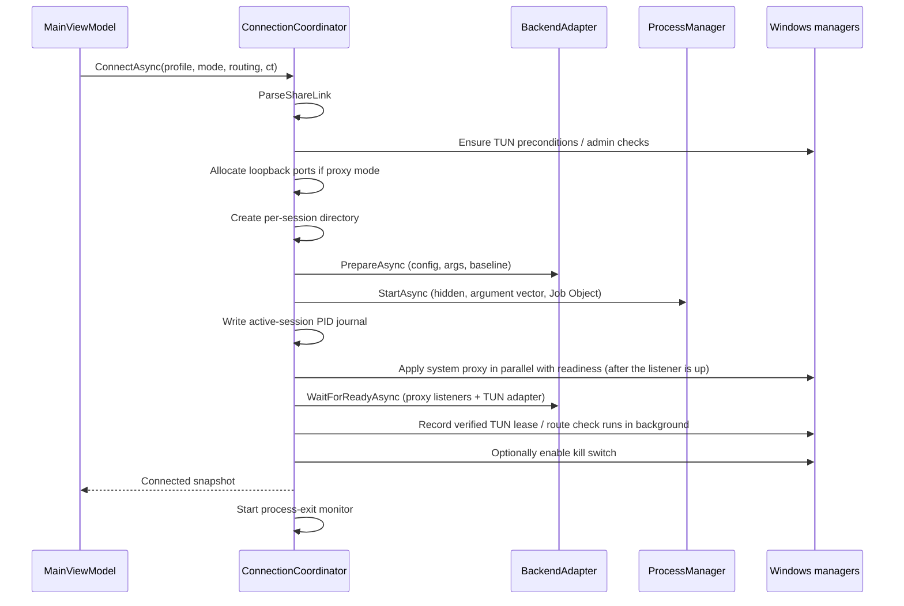

# BusterVPN architecture

This document is the design contract for the code in this repository. It describes the layer boundaries, the connection state machine, Windows side effects, failure ordering, routing semantics, and the remaining production work.

## 1. Goals and non-goals

### Goals

- One UI and one lifecycle model for two independent CLI cores.
- Safe process containment: no shell, no visible console, no orphaned tunnel core after a UI crash.
- Deterministic Windows side effects. Every mutation (proxy, firewall, route ownership) has an owning service, an ordering rule, and a recovery path.
- Credentials remain in memory/DPAPI-protected storage and short-lived per-session files.
- TUN and system-proxy exposure are independent switches and can run together; local-only mode keeps the core's HTTP/SOCKS listeners without changing Windows settings.
- Extensible backend adapter layer so a third core can be added without touching the state machine or UI.
- A polished, responsive WPF experience with no runtime NuGet dependencies.

### Non-goals in this foundation

- Implementing Xray/Hysteria2 protocols in C#.
- A kernel driver, WFP callout driver, or Windows service.
- Unsigned binary replacement: updates are SHA-256 verified, but there is no Authenticode publisher check yet.

## 2. Layer map



### Project boundaries

| Project | Responsibility | Must not reference WPF |
|---|---|---|
| `BusterVPN.Core` | Protocol-neutral models, share-link parsers, subscription/deep-link/JSON/YAML parsers, config builders, routing rules, process contracts, log redaction, version metadata | Yes |
| `BusterVPN.Windows` | Windows APIs, process execution, registry/WinINET, firewall, Wintun checks, DPAPI, ACL hardening, URI-scheme registration, file stores | Yes |
| `BusterVPN.App` | Composition root, state machine, backend adapters, subscription workspace, cloud channel, localization, UI and view models | WPF app |
| `BusterVPN.Tests` | Unit/integration tests for Core + Windows | No |

This separation provides a testable pure core and keeps Windows API risk concentrated in a reviewable project. `BusterVPN.App` is the only project with `UseWPF`.

## 3. Backend adapter contract

`IBackendService` (`src/BusterVPN.App/Services/BackendContracts.cs`) abstracts everything core-specific:

```csharp
Task<PreparedBackend> PrepareAsync(BackendRequest request, CancellationToken ct);
Task<BackendReady> WaitForReadyAsync(
    PreparedBackend prepared,
    IManagedProcess process,
    IProgress<ConnectionProgress> progress,
    CancellationToken ct);
Task CleanupAsync(PreparedBackend prepared, CancellationToken ct);
```

`PrepareAsync` does not start the process. It:

1. validates the core executable,
2. writes an isolated config into the per-session directory,
3. records a pre-launch network-interface baseline,
4. builds the argument vector,
5. returns the readiness strategy metadata.

`WaitForReadyAsync` probes rather than trusting a startup banner:

- Xray proxy: loopback TCP connect on SOCKS and HTTP listeners.
- Hysteria2 proxy: loopback TCP connect on SOCKS and HTTP listeners.
- Xray/Hysteria2 TUN: wait for a new/expected Wintun adapter and a usable IPv4 address. The IPv4 default route is then confirmed in the background within three seconds; a missing route is logged as a warning instead of blocking the session.

### Xray

`XrayConfigBuilder` is the sole owner of JSON schema:

- proxy mode: loopback SOCKS5 + HTTP inbounds with sniffing;
- TUN mode: native Xray `tun` inbound named `BusterVPN_TUN` with explicit CIDR prefixes `ip = 172.19.0.1/30` and `gateway = 172.19.0.1/30`, `dns`, `autoSystemRoutingTable = 0.0.0.0/0, ::/0`, and `autoOutboundsInterface = auto`; a bare address would panic the Go core in `netip.ParsePrefix`;
- VLESS Reality/TLS, XTLS-Vision flow, WS/gRPC/HTTPUpgrade;
- VLESS, VMess, Trojan, Shadowsocks outbounds;
- direct/block/proxy routing tags;
- TUN mode dials the proxy server by its pre-resolved IPv4 (the address covered by the `/32` bypass route) and writes a static `dns.hosts` mapping, so Xray never resolves the proxy hostname through the tunnel. SNI, REALITY `serverName`, WebSocket/HTTPUpgrade `Host`, and gRPC `authority` keep the original hostname;
- TUN mode binds both `proxy` and `freedom` (`direct`) outbounds to the physical egress NIC with `sendThrough` (local IPv4) and `streamSettings.sockopt.interface`, so direct rules and Xray's own DNS sockets cannot loop back into `BusterVPN_TUN`.

See the [Xray TUN documentation](https://xtls.github.io/config/inbounds/tun.html) for the platform behavior and the [REALITY documentation](https://xtls.github.io/config/transports/reality.html) for the client-side fields.

### Hysteria2

`HysteriaConfigBuilder` emits YAML where every scalar is a JSON-quoted string (valid YAML) to prevent structure injection. It supports:

- server/auth/TLS/SNI/pin/ECH;
- Salamander and Gecko obfuscation;
- bandwidth (Brutal when bandwidth is set);
- SOCKS5 + HTTP inbounds in system-proxy mode;
- TUN with `route.ipv4/ipv6` and `ipv4Exclude/ipv6Exclude` in TUN mode.

The TUN schema follows the Hysteria `tunConfig` fields (`route.ipv4Exclude`, etc.). See [Hysteria2 full client config](https://v2.hysteria.network/docs/advanced/Full-Client-Config/).

## 4. Connection state machine

All transitions are serialized behind one `SemaphoreSlim` in `ConnectionCoordinator`.



`ConnectionSnapshot` is immutable and published through `StateChanged`. The UI marshals to the WPF dispatcher. The snapshot contains no credentials.

### Connect sequence



The entire connect transaction is inside the state gate. If the user requests disconnect while readiness is pending, `DisconnectAsync` cancels the linked readiness source **before** waiting for the gate. This avoids a 40-second deadlock while preserving serialized teardown.

### Disconnect and switch ordering

Teardown is deliberately ordered to avoid privacy leaks:

1. Mark session intentional; stop the core process tree and wait.
2. Wait for the TUN adapter to leave `Up` (best effort, bounded).
3. Run adapter cleanup (config files) and delete the session directory.
4. Restore the WinINET proxy and PAC/AutoDetect values.
5. Release the kill switch (only after the core is dead and the proxy no longer points to a dead port).
6. Clear the PID journal, detach output handlers, dispose the process handle, publish `Disconnected`.

An important ordering choice: in proxy mode the core is stopped **before** the proxy is restored. That creates a brief fail-closed window instead of leaking traffic around a dying tunnel. With kill switch armed, firewall blocking remains until step 5.

If any step fails, the session is retained as `Faulted` and a retry of Disconnect is possible. Journals remain on disk for startup recovery.

### Switching backends/servers

`ConnectAsync` first disconnects the current session to completion, then starts the new one. There is no port reuse or proxy overlap between sessions. A failed cleanup aborts the switch rather than starting a second core.

### Unexpected core exit

The monitor distinguishes intentional stop:

- If the core exits while a session is active and not stopping, the coordinator:
  - restores the system proxy so new connections do not point to a dead listener;
  - deletes session secret files;
  - **leaves the kill switch armed** (fail closed);
  - publishes `Faulted` with an actionable message.
- The user must explicitly disconnect/reset to release firewall policy. This is intentional kill-switch behavior.

## 5. Process containment

### ProcessManager

- Requires an absolute executable under an allowed root.
- Rejects non-`.exe` files and symlinks resolving outside the root.
- Starts with `UseShellExecute=false`, `CreateNoWindow=true`, hidden window style, redirected stdout/stderr.
- Passes each argument through `ProcessStartInfo.ArgumentList` (no command-string concatenation, no shell injection).
- Sets `NO_COLOR=1` to keep logs parser-friendly.
- Reads stdout and stderr concurrently; a bounded recent-output ring is available to readiness probes.
- Strips leading core timestamps (for example `2026/10/23 21:57:05.996936`) at ingestion, because the log view has its own time column.
- Classifies stderr by explicit level/failure phrases rather than by stream: Wintun lifecycle lines such as "Using existing driver 0.14", "Creating adapter", and "Removed orphaned adapter" stay informational (OUT), explicit `[Warning]` lines remain warnings, and "Failed to find matching adapter name", `[Error]`, and panic lines are surfaced as errors.
- Logs only the executable display name and PID, not raw argv.

### Job Object

Each child is assigned to a Windows Job Object with:

- `JOB_OBJECT_LIMIT_KILL_ON_JOB_CLOSE`
- `JOB_OBJECT_LIMIT_DIE_ON_UNHANDLED_EXCEPTION`

If the UI crashes, the OS closes the job handle and terminates the core tree. Explicit stop calls `TerminateJobObject` and falls back to `Process.Kill(entireProcessTree:true)` if the job cannot terminate. This is the primary orphan defense. [`SetInformationJobObject` / Job Objects](https://learn.microsoft.com/windows/win32/procthread/job-objects).

### SessionJournal

A small JSON journal records:

- core PID,
- canonical image path,
- core process start time.

At startup, the coordinator kills the recorded PID only if both the image path and process start time match within 8 seconds. This avoids PID-reuse accidents and covers the rare case where Job Object assignment failed.

### Ports

Xray/Hysteria proxy mode prefers `127.0.0.1:10808` (SOCKS5) and `127.0.0.1:10809` (HTTP), then scans a bounded range. Both TCP and UDP are probed for availability. A race with a foreign bind is handled by post-launch readiness failure and full rollback.

## 6. System proxy mode

`SystemProxyManager` owns:

`HKCU\Software\Microsoft\Windows\CurrentVersion\Internet Settings`

Values modified:

- `ProxyEnable = 1`
- `ProxyServer = http=127.0.0.1:<http>;https=127.0.0.1:<http>;socks=127.0.0.1:<socks>` when both listeners exist
- `ProxyOverride = <local>; ...custom direct-domain bypass`
- `AutoConfigURL` temporarily removed
- `AutoDetect` temporarily disabled

Why not a bare `ProxyServer=127.0.0.1:10808`? WinINET's manual proxy field is HTTP-oriented. Pointing an HTTP download at a SOCKS listener fails. Both protocol-specific HTTP and SOCKS entries are written so WinINET applications work while SOCKS-aware software can still use 10808.

### Transaction and recovery

1. Capture every original value.
2. Write `system-proxy.backup.json` atomically, including the exact applied proxy string, writer PID, process start time, and journal stage (`Applying`).
3. Apply values.
4. Call `InternetSetOption(INTERNET_OPTION_SETTINGS_CHANGED)` and `INTERNET_OPTION_REFRESH`.
5. Read back, verify, and upgrade the journal stage to `Applied`.

On normal teardown the exact snapshot is restored. On crash, startup checks whether the current values still equal the applied values:

- if the journal belongs to a still-running BusterVPN process, skip the rollback and keep the journal;
- if yes, restore the snapshot;
- if another program changed the proxy, do not overwrite its choice; restore only collateral PAC/AutoDetect values where safe, and discard the journal.

Reference: [`InternetSetOptionW`](https://learn.microsoft.com/windows/win32/api/wininet/nf-wininet-internetsetoptionw).

## 7. TUN mode and routing

BusterVPN does **not** create the Wintun adapter itself in this foundation. Both supported cores own their adapter in TUN mode:

- Xray: native `tun` inbound with auto routes;
- Hysteria2: `tun:` block with route lists.

TUN and the WinINET system proxy are independent switches. Both on emits a TUN inbound plus local HTTP/SOCKS listeners and points WinINET at the listeners. In `TunAndSystemProxy` mode the WinINET write starts as soon as the local listener accepts TCP and runs concurrently with the TUN adapter wait, so the proxy round-trip is removed from the TUN critical path. TUN-only keeps the local listeners (used for the exit-IP lookup) but leaves Windows proxy settings untouched; the rest of the machine follows the TUN route. Proxy-only emits the local listeners and applies WinINET. Neither emits the local listeners but never mutates Windows settings, so applications can opt in to the loopback ports manually.

`TunManager` owns prerequisites and verification:

1. Windows 10 1809+.
2. Administrator rights.
3. `wintun.dll` exists in the `cores` folder, is not a stub, and its PE machine matches the app process.
4. Skip Teredo, ISATAP, 6to4, and loopback pseudo-interfaces; select the new Wintun adapter by name hint/description, preferring the newest match.
5. Require at least one IPv4 address. Adapter polling runs every 150 ms.
6. Confirm in the background that `route.exe print -4` contains either `0.0.0.0/0` through the tunnel interface address or the split-default pair `0.0.0.0/1` + `128.0.0.0/1`. The check is bounded to three seconds and runs every 150 ms.
7. Mark `Connected` once the adapter has an IPv4 address; a late route table is logged as a warning rather than blocking the session.

Teredo is always present and "up" on many Windows installations, has no usable IPv4 address, and its description contains "Tunneling". Matching any interface whose description mentions "tunnel" caused the app to verify Teredo instead of the Wintun adapter and fail with "no IPv4 address". Selection now excludes pseudo-interfaces and accepts any adapter whose name/description contains `BusterVPN` (Xray uses `BusterVPN_TUN`, Hysteria2 uses `BusterVPN`) or `wintun`, ignoring case and whitespace.

Hysteria2 owns its TUN route table through `tun.route` in the generated YAML, so its readiness path waits only for the adapter/IPv4. Xray uses the same non-blocking contract: a route table that is not populated within three seconds produces a warning, while the connectivity probe (`InternetProbe`) still catches a genuinely broken tunnel and surfaces the "tunnel up, no internet" warning.

Before starting a TUN core, `TunManager` resolves the VPN server's IPv4 address(es) and installs `/32` host routes through the physical default gateway (`route.exe ADD ... MASK 255.255.255.255 <gateway>`). This bypass is what prevents the core's own encrypted uplink from being captured by the TUN default route and looping. The routes are deleted in normal teardown, failed-connect rollback, and unexpected core-exit handling. The kill switch also adds an explicit outbound allow rule for those server addresses (in addition to the core executable and loopback rules), so fail-closed mode cannot block the uplink.

DNS: Xray's TUN inbound carries the adapter DNS list (`1.1.1.1`, `8.8.8.8`) and, after the adapter is up, `TunManager.ApplyDnsAsync` applies the same resolvers to `BusterVPN_TUN` with `netsh` before the session is reported connected. Hysteria2's YAML has no adapter-DNS field, so its TUN configuration carries a forward-compatible `dns` hint and the same `ApplyDnsAsync` path configures its `BusterVPN` adapter. The Hysteria2 adapter MTU is 1400 so QUIC encapsulation stays below a 1500-byte path MTU. The `/32` bypass covers only the VPN server, not DNS servers, so name resolution follows the tunnel path once the core is up. DNS leak prevention remains a production-hardening item.

After a TUN session reports connected, `InternetProbe` probes the fallback endpoints (`connectivitycheck.gstatic.com/generate_204`, `cp.cloudflare.com/generate_204`, `www.msftconnecttest.com/connecttest.txt`) concurrently without a system proxy and without following redirects. Xray TUN waits four seconds before the first probe so the adapter DNS and the asynchronous route table are in place; Hysteria2 keeps a two-second grace period. The first healthy endpoint wins; only an all-endpoint failure raises the non-fatal "tunnel up, no internet" warning. A successful exit-IP lookup clears a stale banner.

IPv6 routes are generated for Xray (`::/0`) and Hysteria2 (`::/0`), but the application-side route verifier currently proves IPv4 only. Treat IPv6 full-tunnel behavior as core-owned and verify it in an integration lab before marketing dual-stack full-tunnel coverage. DNS policy is likewise delegated: Xray TUN gets adapter DNS servers, Hysteria uses its resolver behavior, and the app does not implement a DNS leak guard. This matters; see the production recommendations.

On disconnect, the coordinator waits for the adapter to go down; cores own actual adapter deletion. A dormant Wintun adapter is reported but is not forcibly deleted. In production, adapter ownership should move to a dedicated service.

## 8. Kill switch

Implementation: `KillSwitchService` using Windows Firewall COM (`HNetCfg.FwPolicy2`, `HNetCfg.FWRule`). This is not WFP; see the hardening note.

1. Require elevation.
2. Snapshot `DefaultOutboundAction` for Domain/Private/Public.
3. Write `killswitch.backup.json` before mutation.
4. Add narrowly scoped allow rules:
   - active core executable;
   - loopback (`127.0.0.1/32`, `::1/128`);
   - DNS (svchost, UDP/TCP 53);
   - DHCP (svchost, UDP 68→67).
5. Set outbound profile defaults to **Block**.
6. Verify; on any error, remove rules and restore originals.
7. On disconnect, restore defaults **only after** the core has stopped and the system proxy is restored.

If the app crashes while armed, traffic stays blocked (fail closed). Next launch's `RecoverAsync` performs cleanup before the UI can connect. This is a design tradeoff: a fail-open kill switch is not a kill switch; a privileged service/watchdog is the correct production answer.

The rules are intentionally narrow but platform-dependent. In particular, DNS requests proxied through the Windows DNS Client and DHCP must remain reachable or the tunnel itself may not come up after network changes. Enterprise policy may prevent changing defaults; errors are surfaced.

Production hardening:

- WFP provider with boot-time filters, service-owned policy, loopback exemptions and explicit DNS handling;
- watchdog that can restore policy independently of the UI;
- audit/log of policy changes and rule IDs;
- signed service and authenticated IPC.

## 9. Routing matrix
BusterVPN keeps one UI rule set, then maps it to the capabilities of the active core.

| Rule type / feature | Xray proxy | Xray TUN | Hysteria2 proxy | Hysteria2 TUN |
|---|---|---|---|---|
| LAN/private bypass | In-core direct rules | In-core direct rules | ProxyOverride (+ core does not see LAN) | `route.ipv*Exclude` |
| Domain Direct | In-core routing | In-core routing with sniffing | ProxyOverride | **Not applied** (no client domain ACL in supported config) |
| Domain Block/VPN | In-core routing | In-core routing | Not applied | Not applied |
| IP/CIDR Direct | In-core routing | In-core routing | ProxyOverride limited (IP wildcards only) | `route.*Exclude` |
| IP/CIDR Block | In-core routing | In-core routing | Not applied | Not applied |
| Rule ordering | Yes | Yes | N/A | Exclusions only |

The routing page is intentionally minimal: LAN bypass, the rule builder, and the active rule list. The capability differences above are documented here rather than as long explanatory blocks in the UI. Domain bypass in TUN may also be limited by ECH/encrypted SNI; users can express IP/CIDR rules instead.

## 10. Credentials and secret lifecycle

| Secret | At rest | In transit to core | Cleanup |
|---|---|---|---|
| Share links / UUID / passwords / URL tokens | DPAPI CurrentUser in `profiles.bin` | Xray/Hysteria YAML/JSON in session dir | Session dir deleted after stop/failure |
| Subscription URLs (bearer tokens) | DPAPI CurrentUser with purpose-specific entropy in `subscriptions.bin`; masked in UI and logs | Never sent to a core | Removed with the subscription record |
| Xray/Hysteria configs | In-memory + per-session file | Path on argument vector | Session dir deleted |
| Client update package / staged cores | Temporary `.part` files and `updates\staging` under the user profile, ACL-restricted | Never | `.part` deleted on failure; `update.bat` removes staging after relaunch |
| DPAPI key | Windows user profile | n/a | n/a |

- The runtime root inherits the user profile ACL. Session directories and generated core configs receive an explicit protected DACL (current user + SYSTEM) via `FileAcl`. Update staging directories are also ACL-restricted.
- Logs are sanitized for `scheme://user:pass@`, query secrets such as `key/token/auth/password`, subscription path tokens (`/sub/<token>`), and `--key=`-style arguments.
- The UI never displays a raw share link or subscription token; only endpoint/name and a masked URL.
- DPAPI failure quarantines the profile or subscription store rather than overwriting it.
- A profile node imported from JSON/YAML is re-serialized into an equivalent share link (`ShareLinkWriter`) so the connector keeps one parsing path and the encrypted store keeps all payloads.

Production additions: use Credential Manager/DPAPI-NG or a hardware-backed vault; add Authenticode publisher verification for client and core downloads; add process ACL restrictions.

## 11. UI / MVVM design

- Custom chrome dark WPF window, DWM rounded corners/dark mode, responsive grid, 1200×780 default.
- Dashboard: central connect state button, routing-mode segmented control, exit IP/location, approximate throughput graph, session metrics.
- Servers: backend/favorites filter pills, TCP latency (3 attempts, median), import (multi-line / JSON / subscriptions), subscription cards with traffic/expiry, remove.
- Routing: LAN bypass, a minimal custom rule builder with direct/VPN/block actions, and the active rule list.
- Activity: redacted core logs, lifecycle events.
- Settings: autostart HKCU Run, minimize-to-tray, kill switch (with explicit warning), exit-IP lookup opt-out, core/wintun presence, admin status, cloud updates with core/client download buttons and progress, `bustervpn://` link handler status, RU/EN language switch.
- Exit-IP lookup uses the core's loopback HTTP proxy (TUN-only keeps local listeners for this purpose as well), tries `ipinfo.io`, `ip-api.com`, `api.ipify.org`, and `ifconfig.me` with a 15-second request budget, and never affects the active tunnel; a failed lookup renders `Unknown` instead of an error banner or disconnect.
- Tray: NotifyIcon context menu with connect/disconnect, current status and quick server switch; labels follow the selected language and the tooltip carries the `v0.1.5-beta` badge; the server submenu is rebuilt on open.
- Single instance: per-user named mutex + named pipe; a second launch forwards its command line (for example a `bustervpn://` link) to the primary and raises the existing window. A named event remains as an argument-less fallback.
- Localization: `LocalizationService` swaps `Strings.{culture}.xaml` dictionaries and raises `INotifyPropertyChanged`; XAML uses `{loc:Translate Key}` (a reactive binding to `LocalizationProxy`) and view models/tray subscribe to `LanguageChanged`. No element is left on a static English string.
- State flows one way: `ConnectionCoordinator` events → `MainViewModel` → bindings/commands. View models do not start processes or mutate the registry directly.
- Throughput graph is a lightweight custom `FrameworkElement`; no chart package. In TUN mode it selects the tunnel adapter; in proxy mode it aggregates active interfaces (documented approximation).
- Long-running operations are safe against reentrancy: the coordinator gate serializes tunnel lifecycle; the UI marks transitional state and the connect button intentionally remains actionable to cancel an in-flight readiness wait.

## 12. Failure matrix

| Failure | Observed behavior | Recovery |
|---|---|---|
| Missing core executable | Connection fails before start; Faulted snapshot | Install core or correct directory |
| TUN without admin/Wintun | Preflight failure, no core start | Restart elevated / install matching Wintun |
| Port already taken | Config prepared, start may fail or readiness fails | Full rollback; next attempt allocates another pair |
| Core exits during readiness | Readiness probe fails fast with exit code | Rollback, Faulted |
| Core exits after connected | System proxy restored; kill switch remains armed; Faulted | User disconnects/retries; startup recovery on app crash |
| Proxy apply fails | Core stopped; no committed proxy | Journal removed/rolled back; Faulted |
| Kill switch apply fails after proxy applied | Proxy restored; core stopped; rules/defaults rolled back | Faulted; user can retry |
| App force-killed | Job Object kills core; proxy/killswitch journals remain | Startup recovery restores proxy/firewall before UI use |
| System proxy changed externally | Restore detects mismatch and does not clobber it | Warning logged |
| Kill switch backup unreadable | Recovery logs error, preserves journal | Manual firewall inspection required |
| Adapter remains after stop | Wait logs warning | Core/OS may clean later; no blind destructive adapter deletion |
| Import invalid | UI-level validation error | Correct link |

## 13. Test strategy

Current automated tests (157 passing) cover:

- VLESS Reality Vision parsing and raw-link round-trip;
- VMess base64, SIP002 Shadowsocks, unsupported plugin rejection, Trojan TLS enforcement;
- Xray JSON shape for proxy/TUN, Reality, routing;
- Hysteria2 URI port hopping/obfuscation/bandwidth and YAML route/inbound shape;
- routing normalization (including Cyrillic domain suffixes), ProxyOverride generation;
- log redaction (including subscription tokens);
- DPAPI round-trip, purpose-separated entropy, encrypted profile and subscription persistence;
- subscription bodies (Base64/Base64Url, plain URI lists, Xray/Sing-box JSON, Clash YAML), deep links, `Subscription-Userinfo`, and share-link re-serialization;
- the VPS update manifest format, primary/fallback resolution, malformed-manifest handling, SHA-256 core verification, and migration of the legacy manifest URL;
- streaming downloads with progress/hash verification, safe client-archive extraction (zip-slip/size limits), and the generated `update.bat` script;
- system-proxy string formatting (`http=…;https=…;socks=…`);
- process stdout/stderr containment and stop behavior with Job Objects.

Not covered automatically (requires elevated/lab environment):

- a live Xray/Hysteria handshake;
- Wintun/route teardown across a real adapter;
- firewall policy mutation and crash recovery;
- WinINET proxy visibility in third-party browsers;
- Windows sleep/resume and network-change handling.

A production CI plan should add a privileged Windows runner with disposable VMs and a controlled test server/echo endpoint; simulated core stubs should test readiness/rollback paths without real network access.

## 14. Recommended next milestones

1. Extract a signed privileged broker/service for firewall + TUN route ownership.
2. WFP-based kill switch with service watchdog and boot-time safe default.
3. Add DNS policy (hijack/proxy or direct-with-bypass), IPv6 route verification, and leak tests; document the difference between DNS reachability and DNS privacy in the kill switch.
4. Core binary integrity: Authenticode validation and pinned publisher keys (the manifest already provides per-core SHA-256 and the app verifies downloads).
5. QR import and publisher-signature verification for updates (subscription/deep-link activation, manifest checks, core installation, and the SHA-256-verified self-update are implemented).
6. Structured diagnostics bundle (sanitized) and crash reporter.
7. Import/support for additional Xray transports and SS plugins, or catch and clearly reject with capability UI.
8. Per-server advanced settings (Hysteria bandwidth, kill switch override, DNS) with schema validation.
9. High-contrast theme, screen reader audit, 200% DPI pass (RU/EN hot-switch is implemented).
10. Sleep/resume and network-change state verification plus automatic reconnect policy.
11. Full end-to-end lab tests with actual cores and Windows VMs.

## 15. Universal import, cloud channel, and localization

### Import pipeline

`SubscriptionWorkspace.ResolveAsync` is the single entry point used by the paste button, browser arguments, pipe activations, and the cloud refresh:

1. Classify the payload (`ShareLinkParser.DetectContentKind`): share links, HTTP URLs, deep links, JSON, Clash YAML, Base64 bundle, or mixed.
2. Resolve deep links (`sub://`, `bustervpn://`, `v2rayng://`, `hiddify://`, `clash://`) to plain HTTP(S) URLs, including Base64 and percent-encoded forms.
3. Parse local structured payloads without network access.
4. Download HTTP(S) subscriptions with a 12-second budget, explicit redirect following, an 8 MB cap, and the `BusterVPN/0.1.5-beta (v2rayN; Hiddify; Clash.Meta)` User-Agent.
5. Detect the body format in order: JSON (Xray `outbounds`, Sing-box outbounds), Clash `proxies:`, plain URI list, then recursive Base64.
6. Convert nodes into `ServerProfile` records. JSON/YAML nodes are re-serialized into equivalent share links so the existing connect path re-parses them after a restart.

Subscription metadata (`Subscription-Userinfo`, `profile-title`, `profile-update-interval`) is persisted with the record and rendered on the Servers page. Records live in a DPAPI-protected `subscriptions.bin` with entropy that is distinct from the profile store.

`bustervpn://` is registered under `HKCU\Software\Classes\bustervpn` (no elevation). Clicking such a link starts the client with the URL as an argument, or forwards it through the single-instance named pipe; `App.OnStartup` detects the argument and imports it on the UI thread.

### Cloud channel

`CloudUpdateService` fetches the release manifest from the primary VPS URL `https://vpn.buster.gripe/updates/manifest.json` and falls back to `https://buster.gripe/updates/manifest.json` when the first endpoint is unreachable, returns an HTTP error, or serves invalid JSON. Both URLs are configurable, normalized, and deduplicated by `UpdateManifestResolver`; a response that is received but malformed is reported as a check failure, not as an offline state. Legacy settings pointing at the former `updates.bustervpn.app` placeholder are migrated by `AppSettings.Validate`.

The accepted manifest shape is strict about `version` (required, parseable) and lenient about optional fields:

```json
{
  "version": "0.1.5-beta",
  "publishedAt": "2026-10-21T19:06:47Z",
  "downloadUrl": "",
  "sha256": "",
  "releaseNotes": "…",
  "cores": {
    "xray.exe": { "url": "https://vpn.buster.gripe/updates/cores/xray.exe", "sha256": "…" }
  }
}
```

Invalid URLs, hashes, timestamps, and unsafe core names (`..`, separators, absolute paths) are dropped with warnings instead of rejecting the whole manifest. The advertised `version` is compared with `AppMetadata.NumericVersion` (`0.1.5-beta` → `0.1.5.0`). For each advertised core, the local file under the core directory is hashed with SHA-256 and classified as `UpToDate`, `Outdated`, or `Missing`; the UI reports “N core update(s) available” and the activity log lists the names.

Core installation is performed by `CoreUpdateManager`: each `.part` file is streamed with progress, hashed during download, compared with the manifest SHA-256, and swapped into place atomically (`File.Replace` on the same volume, `File.Move` when absent). A mismatch, missing hash, or write failure deletes the part and leaves the live core untouched. Updating is refused while a tunnel is connected. If every advertised executable core is missing on startup (for example a fresh install), the app downloads them automatically; if only the core required by the selected server is missing, the connect attempt offers a yes/no download prompt instead of failing with “core not found”.

Client self-update is separate and explicit. `AppSelfUpdater` downloads the zip, verifies the manifest SHA-256, extracts it with zip-slip and size limits, writes `update.bat`, launches it, and asks the application to exit. The batch waits for the recorded PID with `tasklist`, copies the staged package with `xcopy`, starts the new `BusterVPN.exe`, and removes the staging directory via `%~dp0`. Source and target paths are passed through `BUSTER_SOURCE`/`BUSTER_TARGET`, so `update.bat` stays ASCII-only and works with non-Latin user-profile paths. It is only available when running as the packaged `BusterVPN.exe`, and only while disconnected. The same startup pass refreshes every auto-updating HTTP(S) subscription. Offline operation keeps cached records and profiles untouched.

### Localization

`LocalizationService` merges the requested `Strings.{ru|en}.xaml`, removes the previous localization dictionary, raises `PropertyChanged("Item[]")` on the service and on `LocalizationProxy`, and then raises `LanguageChanged`. XAML text uses `{loc:Translate Key}` (a one-way binding to `LocalizationProxy`, deliberately not a custom `DynamicResource` expression because those can leak into DataTemplate visual trees). `MainViewModel`, `ServerItemViewModel`, `RoutingRuleItemViewModel`, and `TrayIconService` refresh their computed labels and the tray menu in place; the tray tooltip carries the version badge.
